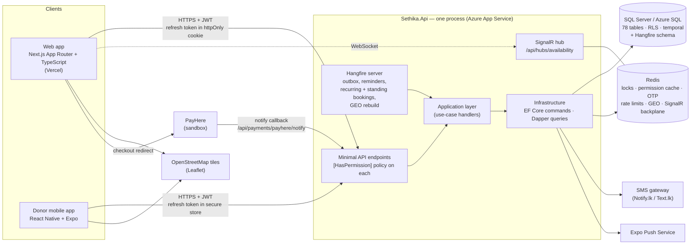
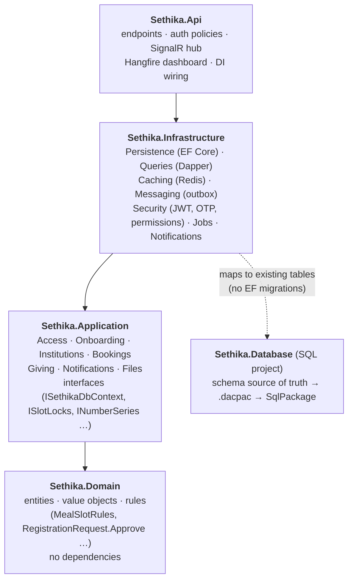
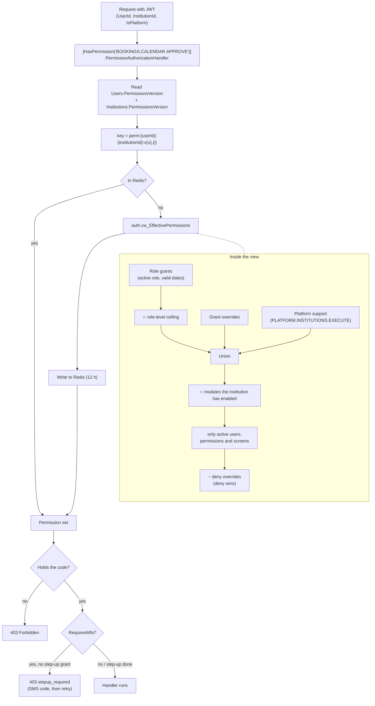
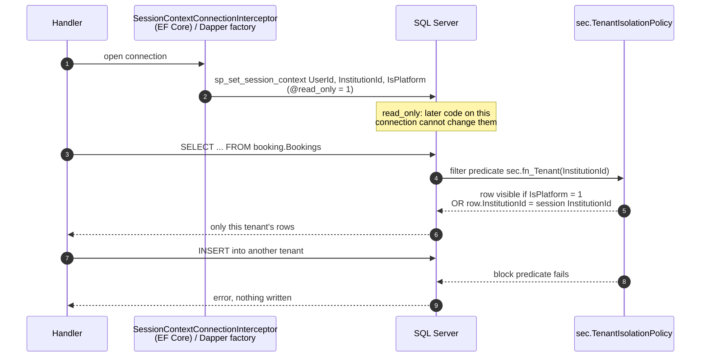
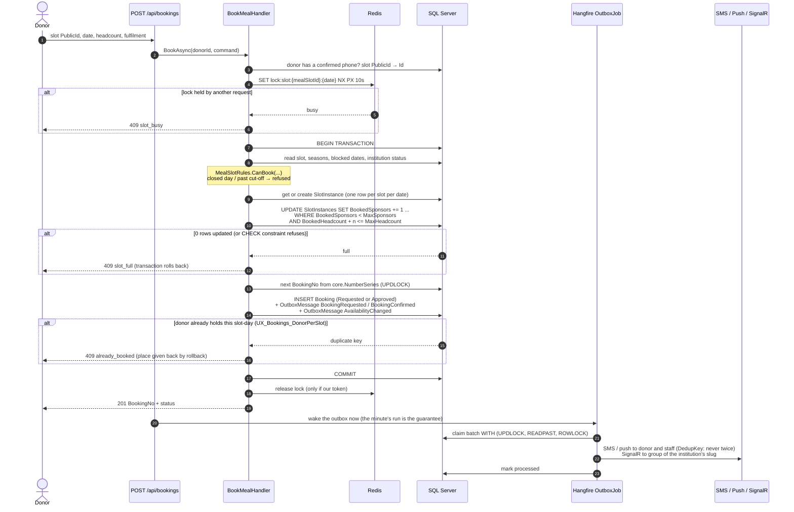
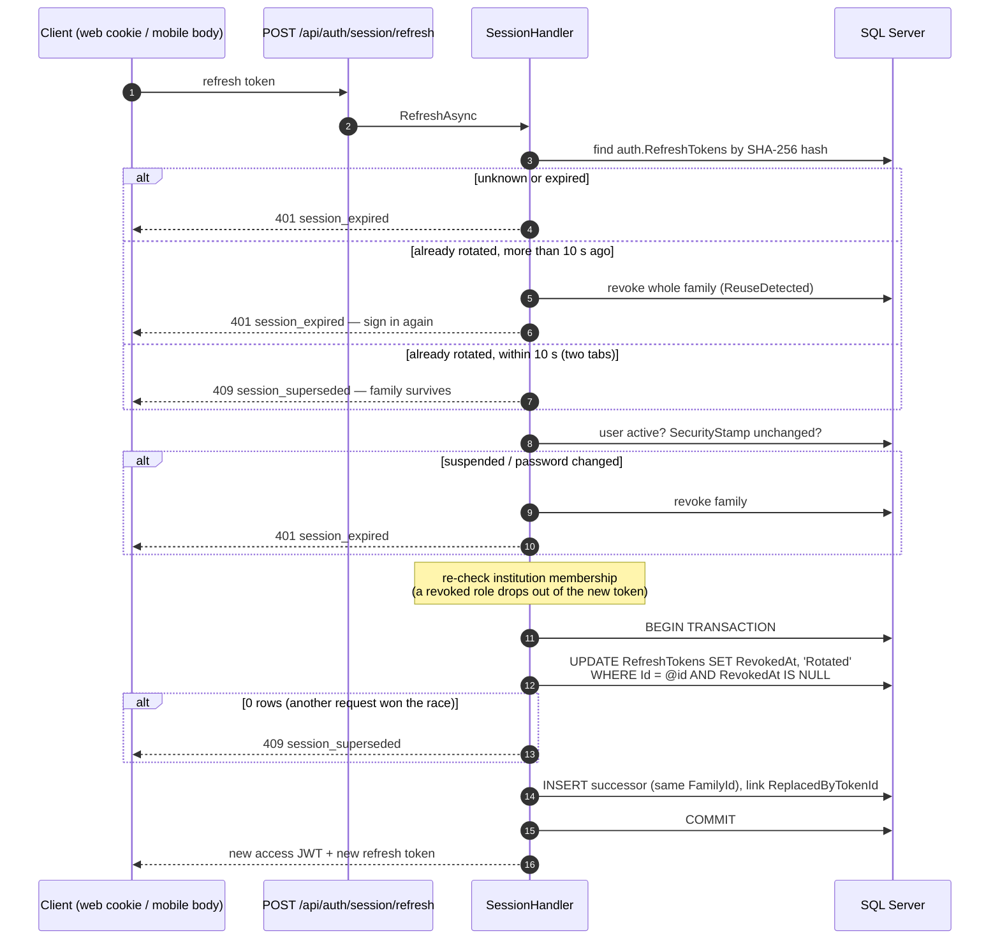
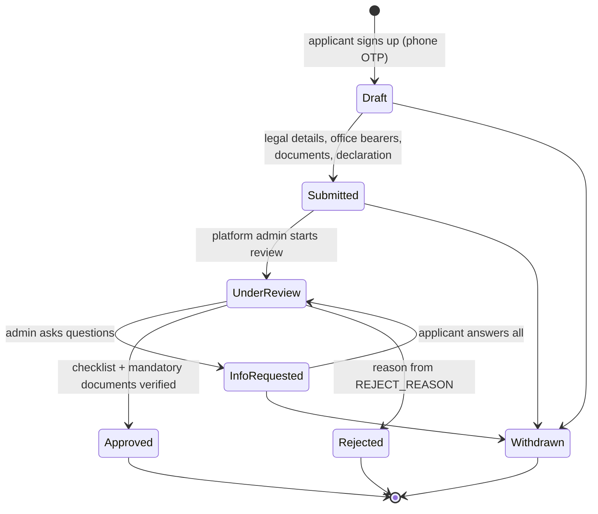

# Sethika — System Diagrams

The UML set for the report (ERDs, class, use case and sequence diagrams as PNG, SVG and PDF) is in
`docs/diagrams/` — see its README. Phase-specific diagrams are in each `PHASE-*.md`. This file holds the
diagrams for the system as a whole: architecture, use cases, the security model (RBAC + RLS), and the
three core flows (booking, session refresh, onboarding approval). Every step shown is in the code; file
names are given under each diagram so the diagram can be checked against the code.

---

## 1. System architecture

One deployable API (a modular monolith). Hangfire and SignalR run inside the same process. There are
two clients, the Next.js web app and the Expo mobile app, and both call the same API.



Source: `src/Sethika.Api/Program.cs`, `src/Sethika.Infrastructure/DependencyInjection.cs`,
`Infrastructure/Caching/*`, `Infrastructure/Notifications/*`, `Infrastructure/Jobs/*`.

---

## 2. Clean Architecture layers and modules

References point inward only. Modules talk to each other through Application interfaces.



---

## 3. Use cases

Mermaid has no use-case diagram, so actors are on the left and use cases are grouped by module.
"Staff" means any institution member; what a staff member can do depends on their role's permissions
(section 4).

```mermaid
flowchart LR
    V(["Visitor"])
    D(["Donor"])
    AP(["Applicant"])
    ST(["Institution staff<br/>(Owner + roles)"])
    PA(["Platform admin"])
    SYS(["System<br/>(Hangfire jobs)"])

    subgraph Access
        UC1["Sign up with phone OTP"]
        UC2["Sign in / step-up MFA"]
        UC3["Switch institution"]
    end

    subgraph Discovery
        UC4["Search institutions<br/>(text + near me)"]
        UC5["View public page,<br/>calendar, needs"]
    end

    subgraph Bookings
        UC6["Book a meal slot"]
        UC7["Book every year /<br/>Memorial Dana Planner"]
        UC8["Manage slots, seasons,<br/>blocked dates"]
        UC9["Approve / reject booking"]
        UC10["Today's sponsors,<br/>mark served"]
    end

    subgraph Onboarding
        UC11["Submit registration<br/>+ documents"]
        UC12["Review, checklist,<br/>clarify, approve / reject"]
    end

    subgraph Giving
        UC13["Donate / pledge to a need"]
        UC14["Record + void receipts<br/>(maker-checker)"]
        UC15["Monthly report + CSV"]
    end

    subgraph Services["Religious services"]
        UC16["Request a service"]
        UC17["Assign leader,<br/>accept / decline"]
    end

    subgraph Admin
        UC18["Manage roles<br/>and permissions"]
        UC19["Platform support<br/>into an institution"]
    end

    subgraph Automation
        UC20["Send reminders<br/>(SMS / push)"]
        UC21["Generate yearly<br/>bookings"]
        UC22["Process outbox"]
    end

    V --> UC4 & UC5 & UC1
    D --> UC2 & UC4 & UC5 & UC6 & UC7 & UC13 & UC16
    AP --> UC11
    ST --> UC2 & UC3 & UC8 & UC9 & UC10 & UC14 & UC15 & UC17 & UC18
    PA --> UC2 & UC12 & UC19 & UC18
    SYS --> UC20 & UC21 & UC22
```



---

## 4. Security model — RBAC and Row-Level Security

### 4a. How an endpoint decides "allowed"

Effective permissions come from one SQL view, `auth.vw_EffectivePermissions`, and are cached in Redis.
The cache key holds two version numbers, so bumping either one makes the old entry unreachable.



Source: `Api/Security/PermissionAuthorizationHandler.cs`, `Infrastructure/Security/PermissionService.cs`,
`Database/auth/Views/vw_EffectivePermissions.sql`.

### 4b. Row-Level Security on every connection

Even when a handler's query forgets a tenant filter, SQL Server filters the rows itself.



Background jobs open their connections with `IsPlatform = 1` (`Infrastructure/Jobs/JobScopes.cs`).
Source: `Infrastructure/Persistence/SessionContext.cs`, `Database/sec/Functions/fn_Tenant.sql`,
`Database/sec/SecurityPolicies/TenantIsolationPolicy.sql`.

---

## 5. Booking a meal (the booking engine)

Three layers stop overbooking: the Redis lock, the conditional `UPDATE`, and the `CHECK` constraints.
The booking and its outbox messages are saved in one transaction; SMS, push and the live calendar
update happen afterwards, from the outbox.



If Redis is down the booking continues without the lock: layers 2 and 3 alone still make overbooking
impossible. Source: `Application/Bookings/Engine/BookMealHandler.cs`,
`Infrastructure/Caching/RedisSlotLocks.cs`, `Infrastructure/Persistence/SqlSlotInventory.cs`,
`Infrastructure/Messaging/OutboxProcessor.cs`.

---

## 6. Session refresh — rotation with reuse detection

Each refresh token can be spent once. If a spent token comes back more than 10 seconds after it was
rotated, two parties hold it, so the whole family is revoked. Every dead session gets the same
answer (`401 session_expired`), so a replayed copy learns nothing about why it failed.



Source: `Application/Access/Session/SessionHandler.cs`, `Api/Endpoints/SessionEndpoints.cs`,
`Api/Endpoints/MobileSessionEndpoints.cs`.

---

## 7. Institution onboarding

### 7a. Registration request states



### 7b. Approve — one transaction

```mermaid
sequenceDiagram
    autonumber
    actor A as Platform admin
    participant H as ApproveRegistrationHandler
    participant S as SQL Server

    A->>H: POST /api/admin/registrations/{requestNo}/approve<br/>(ONBOARDING.REQUESTS.APPROVE, RequiresMfa)
    H->>S: BEGIN TRANSACTION
    H->>S: decision locks (request, slug, owner)
    H->>S: load request; mandatory documents + checklist done?<br/>decider ≠ applicant?
    alt not ready
        H-->>A: error, nothing written
    end
    H->>S: InstitutionCode from core.NumberSeries + free slug
    H->>S: INSERT org.Institutions (Active)
    H->>S: copy verified documents → InstitutionDocuments
    H->>S: enable modules (type defaults + plan)
    H->>S: clone template roles + their permissions
    H->>S: applicant → member (IsOwner) + OWNER role<br/>bump Users.PermissionsVersion
    H->>S: request → Approved; status histories
    H->>S: audit log row (ids only, no personal data)
    H->>S: OutboxMessage InstitutionApproved
    H->>S: COMMIT (any failure rolls back all, number included)
    H-->>A: InstitutionCode + slug
```

Source: `Application/Onboarding/Approval/ApproveRegistrationHandler.cs`, `Domain/Onboarding/RegistrationRequest.cs`.
