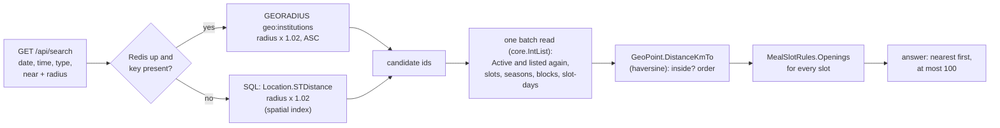

# Report chapter draft: Public pages, cross-institution search and the map (Phase B)

Draft for the final report, written when the phase was finished (2026-11-01). Decision numbers
(G1-G11) refer to `docs/plans/06-DISCOVERY.md`; the summary is in `docs/DECISIONS.md`.

## 1. Why this phase exists

Phase A made it possible to book a meal at one institution, once the donor already knew where to go.
That leaves the donor's first question unanswered: *where can I give?* Sri Lanka has thousands of
temples, kovils, mosques, churches and care homes, and before Sethika a donor would call them one by
one to find a free day.

Phase B answers that question across every institution at once. It also makes each institution
findable from outside Sethika, because a search engine can now read its public page.

## 2. What was promised and what was built

Proposal v3 makes four promises for this phase. All four are built.

| # | Promise | Where it lives |
|---|---|---|
| 1 | Public institution pages, rendered on the server so that search engines can read them | `/i/{slug}` as a server component with metadata, schema.org JSON-LD, `sitemap.xml` and `robots.txt` (section 6) |
| 2 | A donor searches every registered institution at once by date, meal slot, institution type and distance: "Which institutions near Galle have a free lunch slot on 14 March?" | `GET /api/search` (`AvailabilitySearch`); the `/find` page (section 7) |
| 3 | Distance filtering is powered by Redis geo search | The `geo:institutions` set and `GEORADIUS`, with SQL Server as the fallback and the judge (section 4) |
| 4 | The answer is shown on a list, one calendar and an interactive map (Leaflet with OpenStreetMap) | The list, the month view (`GET /api/search/month`) and `FindMap` on `/find` |

No table was added. `org.Institutions` already had coordinates, a persisted `geography` column and a
spatial index, and `booking.AvailabilitySearches` already existed for the search log. The phase is
code, an index in Redis and three anonymous endpoints.

## 3. One judge for every question

A search answers "which institutions have a slot that can be booked on that day?". Whether one slot
can be booked on one day is already decided elsewhere in Sethika. The institution's own calendar and
the booking engine both call `MealSlotRules.Openings`, which looks at the slot's days of the week, its
season, the advance-booking window, a day the institution has blocked and the places already taken.

The search calls the same function for every candidate slot on every day (G7). The three views can
therefore never disagree. If the search said a slot was free, the calendar shows it free and the
engine accepts the booking, unless a donor took the last place in the meantime. The results are not
cached for the same reason: a cached "free" that has just been booked would send donors to a full
slot. The engine would refuse it, but the search would have lied.

Calling the function for every candidate must not cost one query per institution. One batch read
fetches, for all candidates at once, their slots, seasons, blocked dates and the day's slot instances.
The candidates' ids go to SQL Server as a table-valued parameter (`core.IntList`).

**Time of day without a meal type (G2).** The proposal asks for "a free lunch slot", but a slot has
no meal type. It is a name and a start and end time. Adding a type would have meant asking every
institution to classify slots it already has. Dana times follow custom, so the start time already
says which meal it is: morning before 10:30, midday from 10:30 until 15:00, evening from 15:00. The
boundaries live in one place (`MealTimes`), and they are a rule of the search, not of the database.

## 4. Redis GEO as an index, SQL Server as the truth

### The problem

The proposal promises distance filtering powered by Redis geo search. Redis keeps a sorted set of
points, and `GEORADIUS` returns the members within a radius, nearest first, in well under a
millisecond. Redis is a cache, however: it can be down, its key can be missing after a restart, and
it can lag behind the database by one outbox run. Sethika's rule since the booking engine (C2) is that
Redis may make something fast, but only the database may make it correct.

A plain fallback ("ask SQL Server when Redis does not answer") is not enough on its own. Redis
measures distance on a sphere of radius 6372.8 km. SQL Server's `geography` measures on the WGS 84
ellipsoid. East-west near Colombo the two differ by about 0.12 %. An institution 4.9996 km away can
therefore be inside a 5 km circle by one measure and outside it by the other. If each path decided by
its own measure, the answer at the edge would depend on whether Redis happened to be up.

### The design (G4, G5)

Neither measure decides. Both paths only **fetch candidates**, from a circle 2 % wider than the one
asked for:

1. **SQL re-checks** that every candidate is still `Active` and publicly listed, because the index
   can lag an outbox run.
2. **One haversine** on the mean-radius sphere (`GeoPoint.DistanceKmTo`, 6371.0088 km) decides who is
   inside the circle and in what order. It is the same code on both paths.
3. `Openings` decides which of their slots can be booked that day (section 3).

The two paths therefore give the same institutions in the same order, and a Redis outage costs speed,
not correctness. A test proves it at the edge: an institution placed 4.9996 km east of the search
point is found with Redis and without it. With the 2 % margin removed, one of the two paths loses it.

### Keeping the index current

Only `Active` and listed institutions are in the set. Three things keep it right:

- **A rebuild from SQL** when the host starts and every night at 03:00 Colombo time (the Hangfire job
  `geo-index-rebuild`). It runs as one `MULTI/EXEC` of `DEL` and `GEOADD`, so a search never sees half
  an index.
- **An outbox handler** on `InstitutionListingChanged`. Turning the listing on or off is today the
  only change that moves an institution in or out. A suspension or a new address would raise its own
  event to the same handler.
- **A refresh that finds no key rebuilds everything.** It does not create a set with one member,
  which would make every other institution disappear from the fast path until the night.

Even if one message were missed, the nightly rebuild makes the set converge.

The local Redis is version 3.2, which has `GEORADIUS` but not the newer `GEOSEARCH` (6.2). Managed
Redis still accepts `GEORADIUS`, so the same command works in both places.

## 5. One calendar (G6)

The proposal promises "one calendar". A donor rarely has a fixed date: they want a day near a
meaningful one when somewhere is free. `GET /api/search/month` returns, for each day of a month, how
many institutions a day search with the same filters would answer. It reuses the day search's
candidates and the same judge, with one read for the whole month. The page shows the counts on the
same month grid that each institution's page uses (`BowlCalendar`). Choosing a day runs that day's
search. A month may be chosen from the current one up to twelve months ahead.

## 6. Public pages for search engines (G9)

Until this phase `/i/{slug}` was rendered in the browser. Its HTML contained no institution name, so
a search engine saw an empty page.

The page is now a server component. It reads the institution once per request (React `cache`, shared
with the metadata), renders the profile and the meals into the HTML, and hands the same data to the
interactive part, which then does not fetch it again. The head carries a title, a description (the
institution's own, cut at 160 characters, or a sentence in the page's language), a canonical address,
`hreflang` links for English, Sinhala and Tamil, and Open Graph tags. A schema.org JSON-LD block
gives each faith's type (`BuddhistTemple`, `HinduTemple`, `Mosque`, `Church`) or `Place` for a care
home. A `sitemap.xml` lists every listed institution in the three languages, and `robots.txt` keeps
the signed-in screens out.

Two details came from testing:

- **The visitor's budget, not the server's.** The server now reads the API on the visitor's behalf.
  If the API counted those reads against the web server's address, a few busy minutes would exhaust
  one shared rate limit. The server forwards the visitor's address, and a test reads the API's own
  counter to prove the read is counted against the visitor.
- **A page that did not survive in Sinhala.** The meal cards show a cost per person. Node formats
  Sinhala currency as "රු." and Chromium, which has no Sinhala number data, as "LKR". The server's
  HTML and the browser's first render therefore differed, and React threw the server's page away.
  The cost is now written with plain digits, and each language's message carries its own currency
  word. A browser test opens the page in Sinhala and Tamil and fails on any hydration error.

## 7. The search page (G3, G10, G11)

`/find` asks for a day, a time of day, a kind of place and where to look:

- **Near me** uses the browser's location, rounded to three decimals (about 100 m) before it leaves
  the page, and never stored (G3). Refused, unavailable or outside Sri Lanka, the page says what to do
  instead.
- **Search this area** appears after the donor moves the map, and searches around its centre.
- **In a district** chooses one from the list.

No place names are geocoded. A geocoder is an outside service with its own terms, and district
centre coordinates would be invented reference data, which the project's rules forbid. "Near Galle"
is the Galle district, or the map moved to Galle.

Below the filters are the month (section 5), the list and the map. Each card in the list has a number,
the same as its marker on the map. Its name opens the institution's page, and "Book" opens that page
on the chosen meal and day with the booking form already open. On a wide screen the list and the map
sit side by side. On a phone, "List" and "Map" tabs switch between them. The map is Leaflet with
OpenStreetMap tiles and Sethika's own numbered markers (G10).

**The address is the state (G11).** Every filter is in the URL, so a search can be shared ("lunch near
Galle on 14 March") and the back button undoes a filter. Switching the phone's tab replaces the
address instead of adding a step. The first version used Next.js's router, which asks the server for
each new address. A phone test found the flaw: a second tap that landed before the first one was drawn
started from the old address and silently undid the first. The page now changes the address through
the browser's own history API. Next.js keeps its search parameters in step without a round trip, and
each change starts from the address as it is at that moment. A test makes two taps in one JavaScript
task, so that React cannot draw between them, and checks that both count.

The old plain directory at `/institutions` is now a permanent redirect to `/find` in the same
language. Every link that led to it now leads to `/find`.

## 8. Security and privacy (G8)

- **Anonymous but limited.** Searching needs no account. The three search endpoints are anonymous,
  listed as such in `EndpointPolicyTests`, and share the per-client limit of the other public reads.
- **Only what the public page shows.** Names, type, district, city, coordinates, slot names and times,
  and places left. An institution's coordinates are already public through its address. Internal ids
  never leave the server; the answer carries slugs.
- **Nothing about the donor.** Each day search writes one row to `booking.AvailabilitySearches`: the
  date, the type, the district, the radius and the number of results. It records no user and no
  coordinates.
  This is the demand signal a dashboard can read later without knowing where anyone stood.
- **No markup from data.** A marker's popup builds its link with `textContent`, so an institution's
  name can never be read as HTML.

## 9. A database setting changed on the way (D11)

The same branch turned `READ_COMMITTED_SNAPSHOT` on in every database. Azure SQL runs with it on.
Locally it had been off, so plain reads waited for writers. A race that only appears when reads stop
waiting could therefore never be found before production. A deadlock between an admin list and an
approval had also been seen. With the setting on, a search reads the last committed version and never
waits for a booking in progress. That matters little for correctness, because the booking engine
re-checks everything inside its lock, but it keeps the search fast under load. One older test had
relied on a read queueing behind a lock and was rewritten to hold an `UPDLOCK` instead. The 230
race-class tests passed with the setting on.

## 10. Testing

The phase was tested the way the rest of Sethika is: against **a real SQL Server and a real Redis**,
never against substitutes, because the spatial index, the GEO commands and the fallback between them
are exactly what is being tested.

- **Domain tests** (7 test methods): the time-of-day boundaries, the haversine against known
  distances, and Sri Lanka's box.
- **Integration tests** (21 test methods in `SearchEndpointsTests`, plus the job registration and the
  endpoint policy list):
  - only `Active` and listed institutions; only slots `Openings` allows (season, blocked day, full
    slot, advance window); type, district and time-of-day filters; nearest first; the radius edge;
  - **the same answers with Redis switched off and with the key deleted**, compared with the Redis
    answers, and a search proving the Redis path was really used (an institution removed from the
    set by hand disappears until the index is rebuilt);
  - the index following a listing change through the outbox, and a rebuild after a lost member;
  - the month: each day's count equals a count made by hand and the day search's result count;
  - refusals, the search log row (and none for the month), and the shared rate limit;
  - the lookups for the filters (active types, every district, each name in its own language's field).
- **Unit tests in the web project** (23 vitest tests): the metadata, the JSON-LD escaping, the
  sitemap and robots rules, and reading and writing the search address (forgiving parsing, rounded
  coordinates, defaults left out).
- **Browser tests (Playwright)**, 14 scenarios, the key ones also at 320 px:
  - a donor searches near them, sees the place in the list and on the map, picks a day on the month
    and books from the list;
  - a time of day with nothing open says so in words, and back undoes it;
  - moving the map offers "Search this area", and it searches there;
  - location refused says what to do, and a district still finds the place;
  - two taps before a redraw both count;
  - the old address redirects in each language, and every link on the donor's home leads to `/find`;
  - the server's HTML names the place and describes it for search engines; a missing place is a
    404; the sitemap and robots rules; the page hydrates in English, Sinhala and Tamil without an
    error;
  - the Sinhala and Tamil search page on a phone, with nothing wider than the screen.
- **Mutation testing.** Each important line was deliberately broken to check that a test fails: 35
  mutants for the search engine, 10 for the month, 14 for the public pages and 30 for the search page.
  All 89 were killed. Among them: dropping the `Active` or listed filter from the rebuild and from the
  fallback, removing the 2 % margin, sorting by name when a point was given, skipping `Openings`,
  breaking a time-of-day boundary, and the old currency formatting.

  Some survived at first, and each taught something:
  - The lookups' Sinhala and Tamil names were never checked. The seed has none, so swapping the two
    fields changed nothing. The test now gives one type and one district names in both languages
    and checks that each arrives in its own field.
  - A redirect to `/find` without the language survived because the language cookie redirected a
    second time. The test now checks the redirect response itself.
  - The race between two taps did not show reliably through normal clicks. The two-taps-in-one-task
    test now kills both the old router version and a version that reads the address from the last
    render.
  - Two mutants on the map changed nothing at all. The code they touched (a "fitting" flag and a
    first fit to the island) was redundant, and it was removed.
- **The whole suite** at the end of the phase, with `READ_COMMITTED_SNAPSHOT` on: 1016 of 1016 .NET
  tests passed (249 domain, 71 application, 696 integration; the integration run took an hour), and
  109 of 109 browser tests (desktop and 320 px phone).

## 11. Limitations and what was left out

Nothing on the plan's cut order had to be cut. The following were out of scope from the start:

- geocoding typed place names, routes and directions (G3);
- grouping nearby markers into clusters (results are capped at 100);
- searching for religious services across institutions (Phase E);
- availability alerts and the administrator's demand heat map; the search log is kept for them;
- a production tile provider: OpenStreetMap's tile policy allows light use such as a student project,
  and production would move to a paid provider (G10).

Known trade-offs:

- **Sinhala and Tamil names of districts and institution types are not seeded.** Their columns
  exist but are empty, so the search page shows the English name in every language until a reviewer
  supplies them.
- **The index can lag by one outbox run** (up to a minute) after a listing changes. The SQL re-check
  means a place that was just unlisted is never shown; one that was just listed may be missing from a
  near-me search for that minute.
- **A wider radius costs more.** A 50 km circle around Colombo can hold many candidates, and every
  slot of each is judged. The batch read keeps it to one query, and the answer is capped at 100,
  nearest first. No load test was run.
- **Draft translations.** The Sinhala and Tamil texts are drafts written by the developer. They are
  listed in `docs/translations-to-review.md` for native reviewers.
