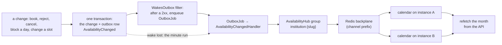

# Report chapter draft: Yearly bookings, the Memorial Dana Planner and live updates (Phase C)

Draft for the final report, written when the phase was finished (2026-11-02). Decision numbers
(H1-H42) refer to `docs/plans/07-ENGAGEMENT.md`; the summary is in `docs/DECISIONS.md`.

## 1. Why this phase exists

Phases A and B made a single booking easy: a donor finds a free day and takes it. Much of Sri Lankan
giving is not a single booking. It is a promise kept every year: a parent's death anniversary, a
child's birthday, a family's dana on the same day each year. It is also tied to the days after a death
(the 7th day, the third month, the 40th day, depending on the faith), which a grieving family must
work out and book at short notice. The proposal names the problem "forgotten commitments".

Phase C makes those commitments hard to forget. It also keeps every open calendar current while
others book, so a donor does not choose a day that went a minute ago.

## 2. What was promised and what was built

| # | Promise | Where it lives |
|---|---|---|
| 1 | Recurring yearly bookings: "a scheduled job reserves the slot for each coming year and notifies both sides" | `RecurringBookingJob` (`recurring-bookings`, 00:30 Colombo), "Book this every year" in the booking sheet, "Every year" in My bookings (section 3) |
| 2 | Real-time slot updates across open calendars, SignalR with a Redis backplane | `AvailabilityHub` at `/api/hubs/availability`, the `AvailabilityChanged` outbox message, the public page and the institution's calendar (section 5) |
| 3 | SMS and email reminders | SMS since Phase A, now also for yearly bookings, memorial days and co-sponsors. **Email is cut** (the user's decision, H1; section 9) |
| 4 | Donor profiles with booking history and preferred institutions | My bookings (history, Phase A), the heart on `/i/[slug]` and "My places" on the donor's home (section 7). Donation history comes with Phase D |
| 5 | The Memorial Dana Planner (added to the scope by the user) | `MemorialObservances` (domain), `core.MemorialRules`, `/memorial` (section 4) |
| 6 | Co-sponsors: several people share one dana (added by the user) | `/share/{token}`, `SqlShareLinks`, `sec.fn_Contributor` (section 6) |

Almost no schema had to be designed. `booking.RecurringBookings`, `booking.MemorialPlans`,
`core.MemorialRules`, `booking.BookingContributors` and `auth.FavoriteInstitutions` were in the first
schema and had never been used. The phase added row-level security to each, a few columns (a public id,
the co-sponsor's answer), draft seeds, and the code.

## 3. A yearly booking is a promise to try

### The problem

"Reserve the slot for each coming year" can be read two ways. Sethika could hold the day for the
donor for every future year, or it could book it for them, the ordinary way, each year when that day
can be booked. Holding it would mean a second kind of reservation that the institution's calendar,
the overbooking guarantee and every report would have to understand.

### The design (H2, H3, H22)

A yearly booking is a promise to *try* (H2). Each year's booking is an ordinary booking with
`Source = 'Recurring'`, made by the same engine as every other booking: the Redis lock, the fresh
read, `MealSlotRules`, the conditional `UPDATE ... WHERE BookedSponsors < MaxSponsors` and the outbox
message, all in one transaction. The institution approves, rejects or cancels it like any other.
Nothing is reserved that the institution cannot see in its calendar, and the overbooking guarantee of
Phase A covers yearly bookings without one new line.

A daily Hangfire job books each active promise's next date **on the first day that date enters the
slot's booking window** (`date − MaxAdvanceDays ≤ today`). It is written in C#, not as a stored
procedure: the volume is one booking per promise per year, and a procedure would have had to repeat
the slot rules, skip the Redis lock and write its own outbox rows (H3).

The year is claimed by a conditional `UPDATE` of `LastGeneratedYear` inside the booking's own
transaction (H22). Two copies of the job running at once, or a rerun after a crash, book the year
once: the second claim updates no row and books nothing. A slot lock that is busy for a second claims
nothing, so the next night tries again instead of losing the year.

### When a year cannot be booked (H4, H21)

The day may be full, the slot switched off or out of season, the day blocked, or the institution
suspended. The donor gets one SMS naming the date, in their own language: `RECURRING_FULL` (try another
day at the same place) or `RECURRING_CLOSED` (try another place), with a link to `/find` for that day.
The job does not retry. A retry loop would compete with other donors for weeks and text the donor each
time, and Phase B already answers "where else can I give that day?".

Other details: 29 February books 28 February in a common year; a filtered unique index allows one
active yearly booking per donor, meal and day; stopping a yearly booking keeps any year already
booked, because stopping must never silently cancel what an institution has accepted (H5).

## 4. The Memorial Dana Planner: configuration, not code

### The problem

After a death, each faith keeps its own days: Buddhists give on the 7th day, after three months and
every year; the Hindu, Muslim and Christian customs have their own. The days are not the same for
every family or temple, and even "the 7th day" is ambiguous: is the day of passing day 1 or day 0?
Sethika must not invent facts about any religion (CLAUDE.md), and it must not hard-code one faith.

### The design (H6, H7, H23, H24)

A memorial rule is a row in `core.MemorialRules`: the faith, a name in three languages, a number of
months, a number of days, and whether it repeats every year. A pure domain function,
`MemorialObservances`, turns a date of passing and a faith's rules into dates: months first, then
days, with the day of passing counted as day 1 (H24). A faith, or an institution's own custom, is a
new row. A reviewer can correct an offset without a code change, and a test proves it: a rule row
added during the test changes the dates the API returns.

The rules were seeded **as drafts** (H7). Every rule's name starts with `DRAFT` and the table is listed
in DECISIONS.md's unconfirmed reference data until someone of each faith confirms it.

The planner (`/memorial`) asks for the name, the relationship, the date of passing and the faith, and
shows each day with its state: booked, to book or past. "Find a place" opens the search (Phase B) on
that day; the booking carries the plan and the rule. A booking for an observance must fall on that
observance's own day (H23), so the planner always knows what is booked. A yearly observance can
become a yearly booking (section 3). One reminder, a week ahead at most, reaches a donor whose
observance has nothing booked (H8, H25). It never contains the deceased's name: template values are
never text a donor typed.

The names of a family's dead are theirs alone. `booking.MemorialPlans` is under a new predicate,
`sec.fn_Owner`, which lets the donor and the platform see a row and never an institution (H27).

## 5. Live updates: a hint, not a copy

### The problem

A calendar shows places left. If another donor takes the last place, the open calendar is wrong until
someone reloads it. The proposal promises that SignalR pushes the change "to every open calendar".

Pushing the new state itself would create a second source of truth that can be lost, late or out of
order. Azure App Service also scales out: a booking handled by one instance must reach a calendar
connected to another.

### The design (H9, H10, H28-H31)

The message is a **hint**: `AvailabilityChanged { slug, from, to }`, "these days at this institution
have changed". A calendar that hears it refetches its month from the API, which is the one truth. A
lost hint costs freshness, never correctness, because the engine refuses a full slot anyway.

- **Through the outbox (H10, H28).** Every change that moves a place writes an `AvailabilityChanged`
  message in its own transaction, so a hint is sent only for a change that committed. Approving
  writes none, because it changes no place.
- **Fast (H30).** The outbox runs every minute, which is too slow for a live calendar. An endpoint
  filter, `WakesOutbox()`, queues the outbox job after a successful change. It runs after the commit,
  never inside it: a job queued before the commit could run first and find nothing. If the wake
  fails, the minute's run delivers.
- **Across instances (H10).** The Redis backplane relays each group message to every instance. Redis
  channels ignore the database number, so a channel prefix from configuration keeps Sethika (and its
  tests) apart from other users of the same Redis.
- **Bounded (H29).** The hub is anonymous, because availability is public. A connection may watch at
  most three institutions, because each watched institution is a Redis subscription on every instance.
- **Which calendars (H11, H31).** The institution's public page and its booking calendar. The calendar
  refetches the month it shows when a hint touches it, and after a reconnect, which may have missed
  hints. `/find`'s counts are not live.

## 6. Co-sponsors: one dana, several families

### The problem

Siblings often give a parent's memorial dana together. A booking has one donor. The others need to see
it, be reminded and appear on the institution's list, without the booking's row-level security being
widened for everyone.

### The design (H16-H19, H32-H38)

- **A link, sent by the donor (H16).** The donor names a person ("Nimal, brings dessert") and Sethika
  makes a link `/share/{token}`: 32 random bytes, of which only the SHA-256 is stored. The donor sends
  it by WhatsApp or SMS themselves. Sethika texts no one: a number typed by someone else is not consent
  to be texted. The link is shown once, with copy and the phone's share menu; the page is `noindex`
  and sends no referrer, so the secret does not reach a search engine or another site's logs (H41).
- **Answers are final (H34, H36).** A signed-in person opens the link and joins or declines. Joined and
  declined cannot be changed or withdrawn; withdrawing an unanswered invitation deletes it, and its
  link then opens nothing. A cancelled, rejected or past booking shows its state and cannot be joined.
  The donor cannot join their own booking.
- **The cap holds under a double click (H35).** At most 10 invitations per booking. The booking row is
  update-locked while counting, so two invitations at once cannot make eleven. The lock writes nothing,
  so the booking's `RowVersion` does not change and no institution decision on it goes stale.
- **Row-level security (H18, H32, H33).** A new predicate, `sec.fn_Contributor(InstitutionId, UserId,
  InvitedBy)`, lets a row be seen by the institution, the co-sponsor and the donor who invited. Three
  things cannot run under the person's own session: finding an invitation by its link (the person is
  on no row yet), answering it, and listing "Shared with me" (the bookings' own RLS shows a booking only
  to its donor and institution). All three live in one class, `SqlShareLinks`, which stamps its own
  connections as the platform. Nothing else in a request gains that reach. The answer is one
  conditional `UPDATE ... WHERE Status = 'Invited'`, so if two people answer one link at once, the
  database decides who was first.
- **What they get (H19, H37, H38).** Joined co-sponsors appear on the donor's booking, by name only on
  the institution's booking, and under "Shared with me". Each gets the 18:00 reminder the day before, in
  their own language, with a dedup key per person.

## 7. Preferred institutions (H12, H39, H42)

A signed-in donor keeps a place with a heart on its page. "My places" on the donor's home lists them,
above "Places you give to", which comes from their bookings. The API is under `/api/me` (the caller's
own rows; no role is needed for a personal preference) and both writes are idempotent. Two taps at once
are stopped by the primary key, not by the look before the insert: a mutation test that removed the
look still passed, which proved that the key is the guarantee and the look only saves a refused
insert.

## 8. Security

- Every new endpoint has a permission policy and is in `EndpointPolicyTests`; the hub and the share
  summary are anonymous and listed as such. The planner has its own screen, `MYMEMORIAL.PLANS`, so a
  role can never hold it by accident.
- Row-level security on every table the phase brought to life: `RecurringBookings` by tenant or
  owner, `MemorialPlans` and `FavoriteInstitutions` by owner only (`fn_Owner`), `BookingContributors`
  by `fn_Contributor`, each with filter and block predicates. Each was tested from every kind of
  session: the donor, another donor, the institution, another institution, the co-sponsor, the platform.
- Rate limits: invitations (30 an hour per account), link reads (120 per 15 minutes per address),
  answers (30 an hour), keeping a place (60 an hour).
- No typed text in a template: neither the deceased's name nor a co-sponsor's note is ever put into an
  SMS.

## 9. Testing

As in every phase, against **a real SQL Server and a real Redis**: the conditional updates, the
filtered unique indexes, the RLS predicates and the backplane cannot be faked.

- **Domain tests:** the yearly date (29 February), the observance arithmetic (months then days, month
  ends, leap years, a yearly rule that crosses the year end), the share token (its form, its hash,
  which bookings can be shared).
- **Integration tests:** `RecurringBookingTests` (14), `MemorialPlanTests` (12), `LiveAvailabilityTests`
  (6), `CoSponsorTests` (9), `FavoritePlacesTests` (5), and the job and policy lists. Among them:
  - the yearly job on the window's first day and not the day before; a rerun; **two runs at once,
    forced**; each refusal texted once per year;
  - **two API hosts on one Redis**: a booking on one is heard by a calendar on the other, and a host on
    another channel prefix hears nothing;
  - **forced races** for the invitation cap (four invitations at nine) and for two answers to one link,
    and for two taps on the heart. Each test waits until SQL Server's `sys.dm_exec_requests` shows the
    requests blocked on one another, never on a fixed delay;
  - RLS from each kind of session, and each block predicate.
- **Browser tests (Playwright)**, `e2e/engagement/engagement.spec.ts`, 13 scenarios on desktop and
  320 px: every year; sharing with join, decline, withdraw, one's own link and the institution's names;
  a memorial day booked through `/find`; the heart; **two browsers on one institution, one books and the
  other's calendar shows the day taken with no reload**; Sinhala and Tamil.
- **Mutation testing.** Each guarded line was broken on purpose and a test had to fail: 35 mutants for
  yearly bookings, 59 for the planner, 24 for live updates (and 4 for its web helper), 39 for
  co-sponsors, 12 for preferred places and 5 in the web screens. All were killed except one, P3 (the look before the heart's insert), which
  survives by design (section 7). Some survived at first, and each taught something:
  - The message name of the live hint survived because the test client listened by the server's own
    constant, so renaming both changed nothing. The client now listens as the web does, by the literal
    name and the JSON fields.
  - The answer's `WHERE Status = 'Invited'` survived because the race test's first request was merely
    slow (it was the host's first), so a two-second wait passed without a race. The race tests now
    wait for SQL Server to show the block.
- **Found by the browser:** the live connection logged a "stopped during negotiation" error when React
  ran its effect twice in development, or when a page was left at once. Next.js raised its error overlay
  over the page. SignalR's log now goes to `console.warn`.
- **The whole suite** at the end of the phase: FULL_RUN_PENDING.

## 10. Limitations and what was left out

Nothing on the plan's cut order had to be cut. Left out, by decision:

- **Email** (the user, H1). Every confirmation and reminder goes by SMS in the donor's language. Email
  needs a confirmation step (no address is confirmed today), a provider and three-language templates.
- **Texting a co-sponsor** (H16): the donor sends the link.
- Co-sponsors' shares of a cost or a donation (Phase D's donations).
- Live counts on `/find` and live updates in the mobile app (H11).
- A per-address limit on connecting to the hub (H29). Sethika's rate limiter is an endpoint filter,
  and a hub's endpoints never run endpoint filters.
- Poya and festival days (`core.SpecialDays` is unseeded, CLAUDE.md's open items).

Known trade-offs:

- **A yearly booking can be refused.** It is a promise to try (H2). If the day is full when it enters
  the window, the donor is told and offered other places. The institution's own regular donors, who
  need a day *held*, are a separate feature (plan 08, standing sponsors).
- **Draft faith data.** The memorial rules, the religions' Sinhala and Tamil names and the Phase C
  texts are drafts, listed for reviewers.
- **A hint can be lost.** A calendar then shows a stale count until its next load or reconnect; the
  engine still refuses the booking.
