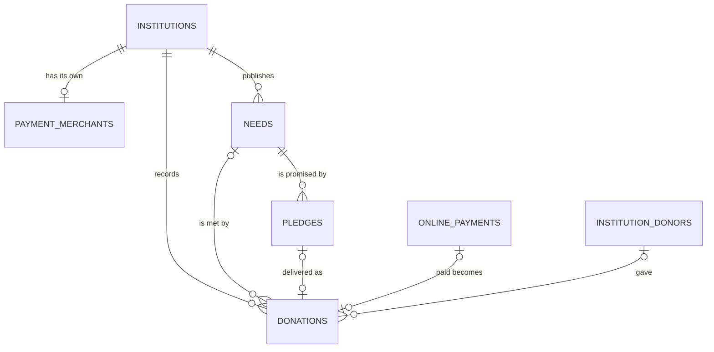
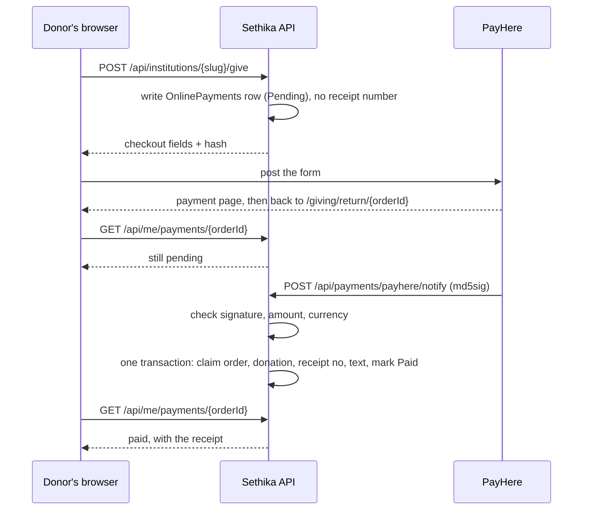

# Report chapter draft: Donations, receipts, the needs board and reports (Phase D)

Draft for the final report, written when the phase was finished (2026-11-06). Decision numbers (M1-M41)
refer to `docs/plans/09-GIVING.md`; the summary is in `docs/DECISIONS.md`.

## 1. Why this phase exists

Meals are not the only thing an institution receives. People give money at the counter, bring dry
rations and school books, and ask what is needed. Phases A to C covered the meal. Phase D covers the
rest of the proposal's promise: a record of what was given, a way to give online, a public list of what
is needed, and figures a committee can read.

Money changes what "correct" means. A wrong booking can be cancelled and booked again. A wrong
receipt, or one that quietly disappears, is a question about someone's honesty. So four guarantees
shaped the design, and each is enforced below the screens:

1. A recorded gift cannot be edited or deleted, only voided by a second person (section 3).
2. A browser cannot make a donation. Only the gateway's signed message can (section 4).
3. One institution's payment secret cannot sign another's payment, and a stolen database backup does
   not show it (section 5).
4. A need can never be promised more than it asked for, even when two donors pledge the last units at
   the same moment (section 6).

## 2. What was promised and what was built

| # | Proposal v3 | Where it lives |
|---|---|---|
| 1 | "Institutions record both money and in-kind donations and issue receipts" | `/giving/donations`, `DonationHandler`, the printable `/receipts/[publicId]` (section 3) |
| 2 | "Online donation payments through PayHere" | `/giving/payments`, the give sheet on `/i/[slug]`, `OnlinePaymentHandler` (sections 4 and 5). Built and tested with signed notifications; **no live sandbox payment was made** (section 11) |
| 3 | "Publish specific needs ... on a public needs board. Donors pledge against a need, and the platform tracks progress until it is fulfilled" | `/giving/needs`, `/needs`, `NeedHandler`, `PledgeHandler`, `NeedCounters` (section 6) |
| 4 | "Monthly booking, utilisation and donation reports, exportable for committee meetings" | `/reports`, its CSV and print layout, `MonthlyReportHandler` (section 7) |
| 5 | "Role-based dashboards" | The giving line on the institution's Day Ledger, "My giving" on the donor's home (section 7) |
| 6 | "Donors keep a profile with their booking and donation history" (the donation half, left over from Phase C) | `/giving/mine` |

CLAUDE.md adds one more: money and receipts are never deleted, only voided by someone other than the
recorder. Plan 08 Q1 had already cut the gratitude wall and part of the reports to make room for
standing sponsors.

`giving.Donations`, `giving.Needs` and `giving.Pledges` had been in the schema from the start, unused.
The work added two tables (`giving.OnlinePayments`, `giving.PaymentMerchants`), the project's first
trigger, columns on the three existing tables, tighter row-level security, a `GIVING` module and a donor
`GIVE` module in the permission catalogue, seeded lists of payment methods, need categories and units,
and 389 new screen strings in each of the three languages.



## 3. A receipt book nobody can alter

### The problem

A committee audits its own book of receipts. A gap in the numbers, or another institution's number in
it, is a question someone has to answer. A receipt that changed after it was issued is worse. Rules in
C# only say what our own code does: a bug, a script or a support session writing to the table would
pass them.

### The design (M1-M7, M22-M25)

**Recording.** Staff record money (amount, method) or items (what, how many, an optional value), the
day it was given, and who gave: a row of the donor book, or a name typed for a walk-in. One transaction
holds the receipt number, the donation, an audit row and the outbox message for the receipt text. Name
and phone are snapshots, as on a booking. A gift on a past day is stored at noon in Colombo, because a
midnight timestamp falls on the previous day in UTC-based reports (M23).

**Numbers.** Receipt numbers are per institution and gap-free: series `RECEIPT`, scoped by the
institution's code, `RCP-2026-000001`, drawn from `core.NumberSeries` inside the donation's transaction.
A rolled-back donation gives its number back. Two institutions can therefore both hold
`RCP-2026-000001`, so the unique key is `(InstitutionId, ReceiptNo)` and URLs carry a `PublicId`
instead (M2).

**The receipt** is a printable page, not a generated PDF: the browser's "Save as PDF" does the work and
no package was added (M4). It is an acknowledgement, not a tax receipt, because a tax receipt needs an
approved-charity status nobody has confirmed. A voided receipt shows **VOID**, the reason and when.

**The receipt text** goes to a donor with an account, or to a donor book row whose consent box is
ticked. A walk-in's typed phone is never texted, because a typed number is not consent (M5). There are
two templates, one naming the amount and one naming no item, since items are typed by staff and no
typed text ever goes into an SMS (M24).

**Voiding** needs a different person from the recorder, the `GIVING.DONATIONS.DELETE` permission,
step-up MFA, a reason and the version that was read (M6). The rule stands twice: the API answers
`void_own_record`, and behind it `CK_Donations_VoidFourEyes` refuses the row. A voided gift stays in
every list, marked, and leaves every total.

**The trigger.** `giving.trg_Donations_Immutable` refuses every `DELETE` and every `UPDATE` that changes
anything but the void columns (M7). It compares the old and new rows with `EXCEPT`, which treats two
NULLs as equal, under a binary collation, so a change of case in a name cannot slip through the
database's case-insensitive one. Once voided, a row can never be voided again or un-voided.

One column had to be allowed to move. Plan 08 links a donor book row to an account when the person
signs in, and that person should then see their receipts. So `DonorUserId` may change, but only on a
gift recorded against a donor book row (M22). A walk-in's or an online donor's account never moves, and
who gave stays the row and the name snapshot: only who may *read* the receipt changes.

A trigger is a new kind of object for this project, and the user chose it over mapping and tests alone
(Q6). The reason is simple: "never edited" should hold even against a bug in our own code.

## 4. Online gifts: only the notification makes a donation

### The problem

After paying, PayHere sends the donor's browser back to a return URL. Anyone can type that URL. If it
made a donation, a person could print themselves a receipt without paying. PayHere also retries
notifications, so the same payment can be reported twice, or twice at once.

### The design (M8, M9, M32-M35)



An order is not a donation. It lives in `giving.OnlinePayments` with no receipt number, because a
payment that has not been confirmed must not take a number from the book (M8). The return page only
shows what the API knows.

The server-to-server notification is the only proof. It is checked in this order: the order exists,
`merchant_id` is the order's merchant, `md5sig` matches when computed with that institution's secret,
and the amount and currency are what was ordered. MD5 is PayHere's choice, used only because the
gateway requires it, and the comparison runs in constant time. Every refusal answers the same 400, with
the reason in the log, so the endpoint does not reveal which orders exist (M35).

**Twice, or twice at once.** A status `2` claims the order with a conditional `UPDATE`, writes the gift,
then marks it paid, in one transaction (M32). The plan had one update, but `CK_OnlinePay_Paid` ties
`Paid` to a `DonationId`, so the claim has to come first. The row lock it takes makes a second
notification wait, find the order paid and stop *before* taking a receipt number, so the book stays
gap-free. `UX_OnlinePay_Donation` is the backstop: a paid order makes one donation, never two.

**A success after a failure.** The claim is `Status <> 'Paid'`, not `= 'Pending'`. A signed success
after a failure means the donor retried and the money was taken, and ignoring it would leave money
received with no receipt, the one outcome worse than a retry. A failure, in turn, ends only a pending
order, so nothing undoes a paid one.

**What it may not refuse.** By the time a success arrives PayHere has the money, so a merchant disabled
or a need closed since the order does not stop it. The notification records what happened. It does not
judge (M35).

**Data not kept.** PayHere's Checkout API requires an email, address and city, which Sethika's
phone-first accounts do not hold. The give sheet asks for them, passes them to the form, and stores them
nowhere, neither on the order nor in the audit row (M33). Inventing an email was the alternative, and it
might have failed PayHere's validation with no sandbox to try it on.

## 5. Each institution's own merchant

### The problem

If one Sethika merchant account took every gift, Sethika would hold donors' money and owe it to the
institutions. The user chose the harder option (Q2): each institution has its own PayHere merchant, so
money goes straight from the donor to the institution. That means Sethika must store each institution's
merchant secret, and a secret in a table is a secret in every backup.

### The design (M10, M21, M36)

`giving.PaymentMerchants` holds one row per institution. The owner enters the merchant id and secret on
`/giving/payments`; saving needs step-up MFA, and the secret is **write-only**: the API never returns
it, only who set it and when.

The secret is encrypted with AES-256-GCM, which is in .NET and needs no package. Each value gets a random
12-byte nonce, and the institution's id is the associated data, so a ciphertext copied to another
institution's row fails its tag and does not decrypt. The row stores `SecretKeyId`, so a key can be
rotated: the current key encrypts, any listed key decrypts. Keys come from configuration, and a missing
or malformed key stops the host at start-up rather than failing a donor's payment.

Each order stores the merchant it was made for. A merchant whose id changed since the order has another
secret, so that order cannot be checked and stays pending: no receipt, in no total, costing only a row.

The public page has no session that could read a merchant, so `/i/[slug]` learns only a yes or a no
through a one-answer platform read, `SqlOnlineGiving` (M36). Institutions with no enabled merchant show
no "Give online", and the API answers `online_giving_off`.

## 6. Needs and pledges: counted inventory again

### The problem

"Fifty school books" is inventory, and pledges are bookings against it. Two donors pledging the last ten
books at once must not both succeed. There is a second, quieter problem: what do the numbers *mean* when
some gifts come with a pledge and some without?

### The design (M11-M15, M29-M31)

A need goes `Draft → Open → Fulfilled / Closed / Cancelled`, and only an open one is public. A pledge is
the booking engine's guarantee again, without the Redis lock, because a need is one row and the
conditional update alone serialises it:

```sql
UPDATE giving.Needs
SET QuantityPledged = QuantityPledged + @q
WHERE Id = @id AND Status = 'Open' AND QuantityPledged + @q <= QuantityNeeded;
```

Zero rows means `need_full` or `need_closed`, and the transaction ends. `CK_Needs_Pledged` is the
backstop. Every move of either counter is in one class, `NeedCounters`, and nothing writes them through a
tracked entity, since reading a need and writing it back would lose a move made in between.

**What the counters mean (M29).** The plan's two rules did not agree. If an unpledged arrival moved
"received" alone, a need could stand at needed 10, pledged 8, received 5. So `QuantityPledged` was given
one meaning: everything spoken for, which is what arrived plus what open pledges still promise. A gift
with no pledge moves both counters under the same condition as a pledge. What is left to pledge is then
always needed less pledged.

**Delivery (M15).** Progress is what arrived, and every arrival has a receipt. Staff mark a pledge
delivered with the quantity actually received: one transaction records an in-kind donation, gives back
what did not come, and turns the need `Fulfilled` when received reaches needed.

**A void reaches the need (M30).** The plan did not say so, but a voided gift leaves every total, and a
need's progress is a total. A void takes the gift out of both counters in its own transaction, and a
need it had fulfilled opens again. A closed need stays closed, with the true count. The pledge stays
`Delivered`, because the delivery did happen; the correction is recording the gift again.

**A person's promise is not swept away.** A need with open pledges cannot be closed or cancelled, and one
that received gifts is closed, not cancelled (M29). Each pledge is delivered or cancelled by name.

**Row-level security (M14).** A donor moves a counter on another tenant's row, which their session must
not be able to do: `giving.Needs` had been open to any signed-in session, so anyone could have changed a
title from raw SQL. It now has a block after update. Pledging and a donor's own cancel run in
`PlatformPledges`, a scope stamped as the platform, whose only inputs are the caller's id and the need's
`PublicId`. The `UPDATE` comes before the pledge's `INSERT`, so its row lock also makes "at most five open
pledges per donor per need" safe against a donor racing themselves (M31).

## 7. Reports and dashboards

### The problem

Utilisation looks like a division: days booked over days served. The hard part is the denominator. Which
days did a slot serve? The rule already exists, in the calendar, and a SQL copy would drift from it.

### The design (M16-M18, M37-M41)

`GET /api/institution/reports/monthly` gives bookings by status, utilisation per meal slot, money by
method, gifts of items by category, voided gifts listed apart and out of the totals, and needs opened,
fulfilled and still open. The figures come from Dapper, in the project's first embedded `.sql` file.

**Utilisation (M37).** Served days are the calendar's own answer: `AvailabilityCalendar.GetAsync` reads
the month and `MealSlotRules.IsServedDay` judges each day's reason. A day out of season or blocked did
not serve, while a full or held day did, so the report cannot disagree with the calendar. A slot counts
from the Colombo day it was made, or a new slot would look barely used. A month not over counts up to
today and says so. Booked days are only served days, so the figure never passes 100%. A slot retired
since shows its booked days and no served days: saying nothing is honest, and a guess is not. There is no
history of a slot's rules, so a past month is judged by its rules as they stand now.

**Which month (M39).** A booking belongs to the day of its meal, a gift to `DonatedAt` in Colombo. A gift
voided later leaves the month it was given in, and a report run again shows that. A committee reads the
month that happened, not the month it was typed in. Quantities of items are not summed, because books and
kilograms do not add; their estimated values are.

**A past month must hold (M40).** Nothing recorded when a need opened or was fulfilled, because
fulfilment happens inside a counter update and the audit log has no row for it. `giving.Needs` gained
`OpenedAt` and `EndedAt`, set in the same `UPDATE` as the status, so "still open" for last month stays
true next year. A void that reopens a need clears `EndedAt`.

**Files (M38, M41).** The CSVs have their own routes instead of `?format=csv`, because a route has one
policy: `EXPORT` is then the endpoint's `[HasPermission]`, which `EndpointPolicyTests` can see. One
writer, `CsvDocument`, adds a BOM so Excel shows Sinhala and Tamil, and puts an apostrophe before any cell
starting `=`, `+`, `-`, `@`, tab or return. Donors' names are typed by people and the file is opened by a
committee, so CSV injection is the one way this file could hurt its reader. Phone numbers are in neither
file.

**Dashboards (M18).** "Role-based" uses the dashboards that exist: the Day Ledger gains a giving line
(this month's money, open needs, pledges due this week, overdue ones included) for those holding
`GIVING.DONATIONS.VIEW`, and the donor's home gains "My giving". A staff member sees no report and no
report link.

## 8. Reaching institutions that already exist

Roles are cloned from templates when an institution is approved, so a place approved before Phase D held
none of the new permissions. A platform action, "Bring roles up to date", fixes that (Q4, M26). It adds
missing core and default modules, missing template roles, and each template grant a copied role does not
hold **and never held**. The last part matters: `auth.RolePermissions` is a temporal table, and its
history tells "the template gained this" from "the owner took this away", so a removed grant stays
removed. It needs its own permission, `PLATFORM.INSTITUTIONS.EDIT`, with step-up.

Using that button exposed a fault of a different kind (M28). The user was asked for a fresh code again and
again and hit the three-an-hour cap, because a step-up was tied to one access token and lost at every
rotation. A step-up now survives a rotation only when the rotation also presents the access token holding
it, and with only the time it had left. The httpOnly cookie alone carries nothing, so a thief of the cookie
inherits no step-up.

## 9. Security

- Every new endpoint has a permission policy and is in `EndpointPolicyTests`. The anonymous ones are the
  board, its lookups and the notification, and all three are rate-limited.
- Staff at the counter hold `DONATIONS.VIEW`, `DONATIONS.CREATE` and `NEEDS.VIEW`. Voiding and reports
  are for those who answer to the committee (M19). `DELETE` on donations means "void": the catalogue's
  actions are fixed, and `EDIT` would mislead more, since donations are never edited.
- Step-up MFA guards the three actions that can hide money or redirect it: voiding, setting the merchant,
  and changing an institution's access from outside.
- **Row-level security, tightened in each direction.** `Donations`, `Needs`, `Pledges`, `OnlinePayments`
  and `PaymentMerchants` all block after update. A donor's session can never insert a donation (M25), or
  a signed-in donor could have made themselves a receipt from raw SQL. It writes nothing on
  `OnlinePayments` either (M34), or it could mark its own order. Reading stays open to the owner.
- **Reach past row-level security from a request** grew by three narrow pieces, each stamped as the
  platform and nothing wider: `PlatformPledges` (M14), `PlatformPayments` (M34) and `SqlOnlineGiving`
  (one yes or no, M36).
- Merchant secrets are encrypted at rest and bound to their institution (section 5). Tests post signed
  notifications with test secrets for two institutions, and one institution's secret cannot sign the
  other's.
- A typed phone is never texted (M5), and typed text never enters a template (M24).
- CSV injection is neutralised in the one writer (M41). Exported files hold no phone numbers.

## 10. Testing

As in every phase, against **a real SQL Server and a real Redis**: triggers, CHECKs, RLS predicates and the
row locks behind the counters cannot be faked. No test calls PayHere.

- **Domain tests:** `DonationTests`, `NeedTests`, `PledgeTests`, `PayHereSignatureTests` and additions to
  `MealSlotRulesTests`. The signature vectors were computed separately with Python's `hashlib`, so the C#
  is checked against something other than itself. The formulas were read from PayHere's Checkout API page
  (updated 4 September 2026).
- **Application tests:** `CsvDocumentTests` and `ReportCsvTests`: quoting, the BOM, and each character
  that starts a formula.
- **Integration tests:** `DonationEndpointsTests` (24), `NeedEndpointsTests` (42), `PaymentEndpointsTests` (61),
  `PaymentConfigurationTests` (22), `ReportEndpointsTests` (27), `TemplateSyncEndpointsTests` (3) and
  `StepUpCarryTests` (5). Among them:
  - receipt numbers: two institutions both starting at 1, two recorders at once getting consecutive
    numbers, and a refused gift giving its number back;
  - the recorder refused by the API and, with the API bypassed, by the CHECK; an amount change and a
    delete refused by the trigger from raw SQL;
  - **forced races**: two donors on the last units, a donor racing themselves on the five-pledge limit, and
    two notifications at once. Each test waits until SQL Server shows the requests blocked on the row,
    never on a fixed delay;
  - a wrong signature, amount or currency changing nothing, and another institution's secret refused;
  - the report on a slot serving only some weekdays, a blocked day, a voided gift, a retired slot and a
    month not over; the CSV with Sinhala names intact;
  - RLS from the institution, another institution, the donor, another donor and anonymous.
- **Browser tests (Playwright)**, `e2e/giving/`: 36 runs, 22 on desktop and 14 at 320 px. They cover cash to printed receipt to a
  void by a second person; a need from draft to fulfilled, delivered short and pledged again; a gift
  through a stand-in for PayHere's page and a signed notification; a failed and an abandoned payment;
  the report, its file and its print layout; each role's giving line; and Sinhala and Tamil at 320 px.
- **Mutation testing.** Each guarded line was broken on purpose and a test had to fail. Across D.1 to D.4,
  304 mutants: 246 in C#, 12 in SQL (the trigger and RLS), 21 in vitest and 25 in the browser. 299 were
  killed. The five that survived:
  - D5, D11, Q1 and Q2 remove a tenant or owner filter from a C# query. Row-level security hides the row
    anyway, so the filter is a second wall and no test can see it fall;
  - T6, the trigger's `IsVoided` comparison, is equivalent: un-voiding must also clear the void columns,
    which the trigger compares too.

  Separately, the step-up carry's mutants C1, C2, C4 and the client's W1 were killed. Some mutants survived
  at first, and each led to a change:
  - a vacuous payment test: its audit read took an old run's row, and it now reads its own;
  - X15: staff were kept off the report only by the API's 403, which looks the same as a broken screen, so
    the test now reads the gate's own words;
  - writing the D.4 mutants found gaps before they ran: rounding, a retired slot in a month not over, a
    gift voided in another month, and the Colombo date in the files.
- **Found along the way:** `?month=0001-01` was a 500 on the donations list, because the month's edge
  cannot be turned into UTC, and `month` must now be between 2000 and 2100 (M41). A public link added in
  D.2 had left six failures in `lib/shell/nav.test.ts`, which D.3 fixed.
- **The whole suite** at the end of the phase, the first full run since plan 08 began, at commit `6391d8f`:
  1508 of 1519 .NET tests passed (418 domain, 99 application, 991 of 1002 integration; the integration run took
  1 hour 44 minutes). Eleven failed, none because of a fault in the product's code:
  - four came from the run itself: an earlier run had been stopped part-way through `StepUpEndpointsTests`,
    which left `RequiresMfa` set on `BOOKINGS.CALENDAR.APPROVE` in the test database, so "give this day" was
    refused. The flag was put back and the tests passed;
  - two showed that M28's development cap of 10 codes an hour had reached the test hosts, which run as
    Development, so the tests of the production cap of 3 failed. `OtpCapInTests` now gives every test host
    the production cap;
  - three were tests left behind by later work: the public page's field list did not have `givesOnline`
    (M36), the job list did not have `standing-bookings` (plan 08), and the approval test did not expect
    `GIVING` among the core modules (M19);
  - two hosts outside Development did not start, because they had no PayHere addresses (M10).

  After the fixes, the 26 classes they touch passed, 391 of 391, including all eleven. Those classes are every
  one that failed and every one that sends a code. The other 611 integration tests were not run again. The
  job list's new check was mutated too (the standing job's time moved), and the test failed as it should.
  Browser: 172 of 172 Playwright tests with one worker in 24 minutes (desktop and 320 px phone, every spec).
  An earlier run with two workers gave 169 of 172: one was the development server's first-compile 500 on
  `/giving/needs`, and two were a test opening the same page twice in a row, which section 11 explains.
  `dotnet format`, `tsc`, `eslint` and `next build` are clean, and vitest passes 279 of 279.

## 11. Limitations and what was left out

**No real payment has been made.** Without a PayHere account (Q1) the form has never been accepted by
PayHere itself. The signatures match its documentation and the flow is proved with signed notifications,
but the first live sandbox payment is still owed. Locally the notification also needs a tunnel, and each
institution must add Sethika's address under PayHere's Integrations and wait for approval, because
PayHere's secret is per domain. The settings screen says so.

From the plan's cut order, that live walk is the only thing not done. Left out, by decision:

- The gratitude wall (plan 08 Q1), donor rankings and any public list of donors.
- Refunds from Sethika: they happen in the institution's own PayHere portal, and staff then void the gift.
  A chargeback likewise changes nothing until staff void it (M35).
- Recurring online gifts, platform tips, tax receipts and a key vault for M21's keys.
- Need images, pledge reminders and lapsing, and linking a donation to a particular booking.
- Charts beyond the report's tables, year-over-year and per-donor analytics, the demand heat map, CSR and
  platform-wide reports, and Excel files (CSV only).
- Phase D in the mobile app.

Known trade-offs:

- **A past month is judged by today's slot rules** (M37), since there is no history of them.
- **Needs from before D.4 have no dates** and count in none of the three need figures (M40). Those rows are
  test data; nothing is in production.
- **Leaving a page during its session refresh can sign a person out** (A19, found by the final browser run).
  The server rotates the refresh token, the browser never receives the new cookie, and the next load is
  refused `409`, because the grace period assumes another tab won. It was seen when a test opened a page twice
  within a second, so a person reloading at that moment would meet it too. Phase D did not change the session
  design, and the test no longer opens the page twice. *Fixed on the hardening day (2026-11-08):* every
  rotation is sent with `keepalive`, so it outlives the page and its cookie lands (A19, amended 2026-11-08).
- **An order whose notification never comes stays `Pending`**, with no job to expire it. It has no receipt
  and appears in no total, so it costs a row (M35).
- **The public board does not know about merchants** (M36), so "Give money" shows only on the institution's
  own page.
- **A place with no meal slots is not listed**, so its needs show on its own page only.
- **`NotifyPerClient` has no test:** reaching the limit takes 3,000 posts.
- The Sinhala and Tamil screen words and receipt texts are drafts, listed in
  `docs/translations-to-review.md`.
