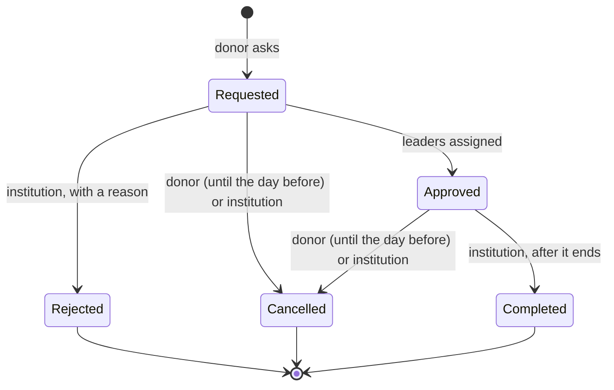

# Report chapter draft: Religious services and leader coordination (Phase E)

Draft for the final report, written when the phase was finished (2026-11-01). Decision numbers
(V1-V39) refer to `docs/plans/PHASE-E-RELIGIOUS-SERVICES.md`; the summary is in `docs/DECISIONS.md`.

## 1. Why this phase exists

After reading the proposal, the supervisor asked for *"a few more functions to the scope, like
coordination of religious leaders and making appointments"*. Proposal v3 answered with Phase E. It
lets a donor ask an institution for a religious service, such as pirith, a sermon, a pooja, a house
blessing or memorial prayers. The institution then plans which of its religious leaders will go.

The phase is faith-neutral in the same way as the meal slots. Sethika knows nothing about any
particular service: each institution types in the services it offers. No list of services per faith
was seeded, because nobody had confirmed one (V4).

## 2. What was promised and what was built

Proposal v3 makes six promises. All six are built.

| # | Promise | Where it lives |
|---|---|---|
| 1 | An institution publishes the services it offers, each with a usual duration, the number of leaders it needs and where it takes place | `booking.ServiceTypes`; the `/services/types` screen; the services shown on the institution's public page `/i/{slug}` |
| 2 | A donor requests a service for a date, time and place; Requested → Approved → Completed / Cancelled, plus Rejected | `POST /api/appointments`; `booking.ServiceAppointments`; the request sheet on `/i/{slug}`; `/services/mine` |
| 3 | Each institution keeps a roster of its leaders, with their usual availability and their leave | `org.ReligiousLeaders`, `org.LeaderWeeklyHours`, `org.LeaderTimeOff`; `/services/leaders` |
| 4 | An administrator assigns leaders who are free; each leader is told and accepts or declines from a personal schedule; a decline returns the request for reassignment | `AssignLeadersHandler`, `AppointmentDecisionHandler`; `/services/appointments` (agenda and assign sheet); `/services/schedule` |
| 5 | Reminders go to the donor and to the assigned leaders | `AppointmentReminderJob` at 18:00 Colombo the day before; SMS through the outbox |
| 6 | A leader can never be committed to two places at once, even if the lock is bypassed | `booking.LeaderTimeBlocks` and its primary key (section 4) |

## 3. Data model

Eight tables were added to the existing schemas, through the SQL project like every other table.
Each one follows the project's conventions:

- times are UTC `DATETIME2(3)`;
- status columns are `VARCHAR` with a named `CHECK`;
- every table owned by a tenant carries `InstitutionId`, and composite foreign keys such as
  `(LeaderId, InstitutionId)` make it impossible to link a leader to another institution's
  appointment;
- public APIs never see an `Id`: they use `PublicId` (UUID v7) or the business number
  `AppointmentNo` (`APT-2026-000123`, drawn from `core.NumberSeries`).

```mermaid
erDiagram
    Institutions ||--o{ ServiceTypes : offers
    Institutions ||--o{ ReligiousLeaders : rosters
    ReligiousLeaders ||--o{ LeaderWeeklyHours : "usually works"
    ReligiousLeaders ||--o{ LeaderTimeOff : "is away"
    ServiceTypes ||--o{ ServiceAppointments : "is asked for"
    Users ||--o{ ServiceAppointments : "asks (donor)"
    ServiceAppointments ||--o{ AppointmentLeaders : "is attended by"
    ReligiousLeaders ||--o{ AppointmentLeaders : "is assigned"
    ServiceAppointments ||--o{ AppointmentStatusHistory : "changes"
    ReligiousLeaders ||--o{ LeaderTimeBlocks : "is committed"
    AppointmentLeaders ||--o{ LeaderTimeBlocks : "holds"
    LeaderTimeOff ||--o{ LeaderTimeBlocks : "holds"

    ServiceTypes { int Id PK; int InstitutionId FK; nvarchar Name; smallint DurationMinutes; smallint BufferMinutes; tinyint LeadersRequired; varchar LocationMode }
    ReligiousLeaders { int Id PK; int InstitutionId FK; uniqueidentifier UserId "optional"; nvarchar DisplayName; varchar Phone "masked"; char Language }
    ServiceAppointments { bigint Id PK; varchar AppointmentNo UK; int InstitutionId FK; uniqueidentifier DonorUserId FK; datetime2 StartsAt; datetime2 EndsAt; varchar Status; rowversion RowVersion }
    AppointmentLeaders { bigint AppointmentId PK; int LeaderId PK; varchar Response; bit RespondedOnBehalf }
    LeaderTimeBlocks { int LeaderId PK; datetime2 BlockStart PK; varchar Kind; bigint AppointmentId; int TimeOffId }
```

Points worth noting:

- **A leader is a person record, not an account** (V1). Many leaders never log in, for example an
  elderly monk or visiting clergy. `UserId` is therefore optional, and an administrator can answer
  on a leader's behalf (`RespondedOnBehalf`). A leader who does log in is linked by phone number and
  given the `LEADER` role in that institution (V21).
- **"Needs leaders" is not stored** (V6). It is computed from the live rows in
  `AppointmentLeaders`, so no status can ever disagree with the rows it describes.
- **The database enforces the rules it can see**, in named CHECK constraints:
  - times sit on a 15-minute grid;
  - a visit at the donor's home has an address;
  - a rejection has a reason;
  - a block points at exactly one source, either an assignment or a leave period.

## 4. The overlap guarantee: time blocks under a primary key

### The problem

The booking engine (plan 03) has to prevent overbooking, which is a **counting** problem: a slot has
`MaxSponsors` places, and a conditional `UPDATE ... WHERE BookedSponsors < MaxSponsors` under CHECK
constraints makes going over impossible. Phase E has a problem of a different shape, **interval
overlap**: a leader assigned 09:00–12:00 must not also be assigned 11:00–13:00 elsewhere, and must
not be on leave at that time.

"No two intervals overlap" cannot be written as a constraint in SQL Server, which has no exclusion
constraints. The usual answers keep the guarantee in application code:

- **A `SERIALIZABLE` (or `UPDLOCK, HOLDLOCK`) range check before the insert.** This is correct, but
  only as long as every code path that writes a commitment remembers the hint. One missing hint and
  a double booking becomes possible.
- **A trigger that checks for overlaps.** This hides logic in the database, against the project's
  rule D3, and it still needs the same locking to be correct.

### The design (V2)

Time is cut into 15-minute blocks. A leader's commitment is written as **one row per block** in
`booking.LeaderTimeBlocks`, whose primary key is `(LeaderId, BlockStart)`. This applies to both an
assignment and a leave period, and the blocks are written in the same transaction as the commitment
itself. An overlap then means inserting a row that already exists. That is a primary-key violation
(error 2627), which the handler answers as 409 `leader_not_free` and names the leader.

"No two intervals overlap" has become "no two rows share a key". **That rule the database can
enforce on its own**, whatever the application code does. A visit at the donor's home adds the
service type's travel buffer before and after (V5), so two home visits across town cannot be booked
back to back.

The cost is that times are aligned to 15 minutes. A three-hour pirith is 12 rows and a week of leave
672. One leave period is capped at 31 days (V18), which bounds a single insert. Donors are only
offered start times on the grid between 05:00 and 21:00 Colombo time (V11), so they never meet the
alignment CHECK.

### The Redis lock in front (V3)

As in the booking engine, a Redis lock comes first: `lock:leader:{leaderId}`, taken with `SET NX PX`
and released with a compare-and-delete script. It turns most races into a fast, clean
409 `try_again` before any database work is done. When an administrator assigns several leaders at
once, the locks are taken in **ascending `LeaderId` order**. That way, two administrators assigning
`{A, B}` and `{B, A}` at the same moment cannot deadlock.

**The lock is an optimisation; the primary key is the guarantee.** If Redis is down, assignment goes
on without the lock and the key still refuses the overlap. A Redis outage therefore degrades the
experience rather than denying the service.

### Freeing time

Removing a leader, a decline, a rejection, a cancellation and a completion all only **free** time.
They take no leader lock (V30). A block deleted a moment early can only let through an assignment
that really is free, because every insert is still guarded by the key.

Every change also writes the appointment's own row. Two concurrent changes therefore always meet on
`RowVersion`: one wins and the other gets 409 `stale` (V31). For example, a leader's decline cannot
slip past an administrator's cancellation unnoticed, and the change that loses frees nothing.

## 5. Two concurrency patterns side by side

| | Meal booking (plan 03) | Leader assignment (Phase E) |
|---|---|---|
| Shape of the rule | Counting: at most N sponsors per slot-day | Overlap: one leader, one place at a time |
| What the database holds | `SlotInstances.BookedSponsors`, one row per slot per day | `LeaderTimeBlocks`, one row per leader per 15 minutes |
| The guarantee | Conditional `UPDATE ... WHERE BookedSponsors < MaxSponsors`, plus CHECK constraints | Primary key `(LeaderId, BlockStart)`; an overlap is error 2627 |
| The first layer | Redis lock `lock:slot:{mealSlotId}:{date}` | Redis lock `lock:leader:{id}`, taken in ascending id order |
| Without Redis | The UPDATE and the CHECKs still hold | The primary key still holds |
| Concurrent decisions | `RowVersion` on `Bookings` (409) | `RowVersion` on `ServiceAppointments` (409 `stale`) |
| Side effects | Outbox in the same transaction | Outbox in the same transaction |

Both follow the same principle: **the lock makes it fast and polite, and the database makes the
wrong result impossible.**

## 6. Workflow, transactions and events



Each step is one transaction. It writes the appointment, a row in `AppointmentStatusHistory` and an
outbox message, as the booking engine does. The SMS texts and the release of time after a donor's
cancellation are handled after the commit by the outbox processor. The messages are
`AppointmentRequested`, `AppointmentApproved`, `LeaderAssigned`, `LeaderDeclined`, `LeaderRemoved`,
`AppointmentRejected` and `AppointmentCancelled`.

A donor's cancellation needs special care (V16). The donor works in a personal session, and
row-level security hides the institution's roster, assignments and blocks from that session. The
donor's transaction therefore cannot delete the leaders' blocks: its DELETE would match nothing. The
blocks are freed instead by the `AppointmentCancelled` handler, which runs in a platform session.
Until the handler runs, which takes seconds, the leader still looks busy. This delay errs on the safe
side: a stale block can only refuse an assignment, never allow a double one. The handler is
idempotent, and it refuses an appointment that is not `Cancelled`. A stray message can therefore
never free a live appointment's time (V27).

## 7. Security

- **Permissions.** Every endpoint has a permission policy from the RBAC catalogue:
  - `SERVICES.TYPES.*`, `SERVICES.LEADERS.*` and `SERVICES.APPOINTMENTS.*` (VIEW, APPROVE, REJECT,
    EDIT) for the institution;
  - `SERVICES.MYSCHEDULE.*` for a leader's own schedule;
  - `MYSERVICES.APPOINTMENTS.*` (scope Self) for the donor.

  The new template role `LEADER` gets only the schedule. The `SERVICES` module is switched on at
  approval only for the four religious institution types (V12). When it is off, the page lists no
  services and requests are refused (V26).
- **Row-level security.**
  - Appointments use `fn_TenantOrOwner`: the institution sees its own, and a donor sees the ones
    they asked for.
  - Leaders, weekly hours, leave, assignments and blocks use `fn_Tenant`.
  - Service types can be read by anyone but written only by their institution, like meal slots.
- **A leader answers only for themselves.** A leader is found through their roster row in the
  session's own institution. A leader not on that roster is refused with 403 `not_a_leader` (V33).
- **Exposure.** URLs and APIs carry only `AppointmentNo` and `PublicId`. Phone numbers are covered
  by dynamic data masking. The public page shows only what a donor chooses by: name, description,
  duration, place and advance window. It does not show buffers or leader counts (V25).
- **Abuse limits.** A donor may make at most 10 requests an hour (V29), because each one takes a
  number from a platform-wide series and some of the institution's attention.

## 8. Notifications and reminders

Texts go out through the outbox, in the recipient's language (English, Sinhala or Tamil), and every
text has a `DedupKey` so that it is never sent twice (V36):

- **The donor** hears about the request, the approval, a rejection, the institution's cancellation
  and the reminder.
- **A leader** hears about being assigned or removed, a cancellation, and the reminder while still
  expected (V37).
- **The institution** gets no texts, as with bookings: a decline appears on its agenda as "needs
  leaders".

A leader without an account is texted at the roster's phone number. A leader with no phone at all is
skipped rather than failed, so the outbox is never held up (V35).

The Sinhala and Tamil leader texts avoid forms of address that would assume one faith (V38). A monk,
a priest, a kurukkal and a moulavi are addressed differently, and the text cannot know which.
Reminders are sent by their own Hangfire job at 18:00 Colombo time the day before (V15, V39).

## 9. User interface

Six screens were added, all in English, Sinhala and Tamil, and all built for a 320 px phone:

| Screen | Who | What |
|---|---|---|
| `/i/{slug}` (services section and request sheet) | donor | Choose a day on the calendar, a start time, and either the institution or home; at home, an address |
| `/services/mine` | donor | Their requests, the status of each, and cancellation |
| `/services/types` | institution | The services offered |
| `/services/leaders` | institution | The roster, each leader's usual week, and leave |
| `/services/appointments` | institution | A day-by-day agenda with four views: upcoming, waiting, needs leaders, history. Also the assign sheet, which shows each leader as free, busy or usually away, and rejection, cancellation and completion |
| `/services/schedule` | leader | What they have to attend, with accept and decline |

The agenda is deliberately not a time grid (V10). It answers the administrator's real question,
"what needs me?", and it works on a phone.

## 10. Testing

The phase was tested the way the rest of Sethika is: against **a real SQL Server and a real Redis**,
never against in-memory substitutes, because row-level security, constraints and locks are exactly
what is being tested.

- **Domain tests** (47 test methods): the request rules, the state machine on `ServiceAppointment`,
  the expansion of a time range into blocks, and weekly hours.
- **Integration tests** (78 test methods across five classes): every endpoint, every refusal,
  row-level security from each kind of session, the SMS texts and the reminder job.
- **Forced races.** A concurrency test that relies on luck proves nothing, so each race is forced:
  1. A separate connection holds an update lock (`UPDLOCK`) on the contested row.
  2. The test waits until `sys.dm_tran_locks` shows every caller queued behind that lock.
  3. Only then does it release the lock.

  This was done for:
  - two assignments of one leader to overlapping times: exactly one succeeds;
  - the same race with the Redis lock bypassed: the primary key still stops it;
  - two administrators assigning `{A, B}` and `{B, A}`: no deadlock;
  - two overlapping leave periods at once;
  - a donor's cancellation against a leader's decline.
- **Mutation testing.** Each important line was deliberately broken to check that a test fails:
  - dropping the primary key, removing the mapping of error 2627, and reversing the lock order
    (8.6);
  - 22 mutants for donor requests, 20 for assignment and answering, and 17 for the texts.

  Every mutant was killed. Four of them (D10, D19, E13, E14) survived at first. The reason was
  instructive: row-level security was already hiding the rows that the mutated check should have
  hidden. Tests from an institution session and from a platform session were added to prove each
  check on its own.
- **Browser tests (Playwright).** Five scenarios cover the whole flow. Three of them also run at
  320 px:
  - an owner sets up a service and a leader, a donor asks for a home visit, the owner assigns a
    leader, and the donor sees "Confirmed";
  - a leader accepts and then declines, and the agenda shows "needs 1 more leader";
  - a rejection with a reason, and a donor's cancellation;
  - leave refused over an appointment;
  - the Sinhala and Tamil screens checked for text cut off at 320 px.
- **The whole suite** at the end of the phase: 973 of 973 .NET tests passed (227 domain, 71
  application, 675 integration).

## 11. Limitations and what was left out

Nothing on the plan's cut order had to be cut. The following were out of scope from the start:

- searching for services across institutions, and showing them on the map;
- leaders shared by several institutions (V8);
- assigning leaders to meal bookings, which is the natural next step;
- automatic assignment (the picker only filters);
- live updates over SignalR;
- a time-grid calendar;
- service types seeded per faith;
- a platform action to switch services on for institutions approved before the phase;
- inviting a leader to create an account from the roster.

Known trade-offs:

- **15-minute alignment.** It is the price of a guarantee the database can enforce.
- **A short delay after a donor's cancellation.** The leader may look busy for a few seconds after
  a donor cancels. The delay is on the safe side.
- **Draft translations.** The Sinhala and Tamil texts are drafts written by the developer. They are
  listed in `docs/translations-to-review.md` for native reviewers.
