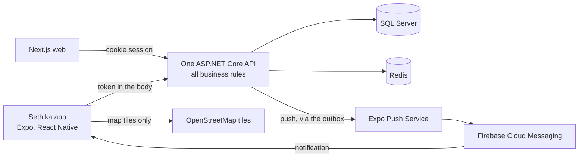

# Report chapter draft: The donor mobile app (Phase F)

Draft for the final report, written when the phase was finished (2026-11-07). Decision numbers (F1-F73)
refer to `docs/plans/PHASE-F-MOBILE.md`; the scope decisions are S7 and S8 in `docs/DECISIONS.md`.

**Read section 11 first.** The app's code is finished and tested, but the finished app has never been
walked through on a real phone, and most of it has never talked to the real API. Everything below
that says "built" or "proved" means proved by tests, unless it says otherwise.

## 1. Why this phase exists

The supervisor suggested on 2026-10-24 that a mobile application would strengthen the project. It also
fits the people: a donor looks for a place to give, and is reminded of a meal, on a phone. Institution
work is form-heavy and already lives on the web. So the app is **donor-first** (F2), and staff get one
thing on it: today's sponsors, and a way to mark a meal served.

The app is another client of the same ASP.NET Core API. It holds no business rules. That one decision
shaped the rest: a screen that wanted something the API did not give meant a change in the API, with
its own tests, never a rule copied into the phone.

Three things are different on a phone, and most of this chapter is about them:

1. There is no cookie jar and no page script, so the session has to travel differently (section 3).
2. A phone can be told things while the app is closed, which needs a second delivery channel beside
   the SMS, with the same "never twice" promise (section 4).
3. A phone knows where it is, which needs care about who else learns that (section 5).

## 2. What was promised and what was built

The plan's §0 lists five promises and says the report must match them. Each is built in code. None has
been proved end to end on a phone, and the last column says how far each one has been seen.

| # | Promise (plan §0) | What was built | Seen so far |
|---|---|---|---|
| 1 | A donor can sign up and sign in (phone OTP, password), reset a forgotten password and change it, in English, Sinhala or Tamil | `(auth)/sign-up`, `sign-in`, `sign-in-code`, `forgot-password`, `change-password`; Profile's language picker; mobile session routes (section 3) | Tests. The session client also ran against a live API in F.2, from a script, not a phone. Password reset and change: never against the real API. Sinhala and Tamil are drafts no native speaker has checked |
| 2 | A donor can browse institutions, see a slot's availability for a month, book, see my bookings and cancel one | Explore, `/i/{slug}`, the month of bowls, the booking sheet, My bookings. One addition: on a regular (standing) day Cancel is replaced by "I can't give that day" (section 7) | Tests. The user tried the first version of these screens on a phone on 2026-10-25, in part, before the redesign. The list was not finished |
| 3 | A donor gets push notifications: booking confirmed, declined, cancelled and the day-before reminder, in their language, never twice | The code is complete on both sides (section 4). Five templates in three languages: `BOOKING_CONFIRMED`, `_APPROVED`, `_REJECTED`, `_CANCELLED`, `_REMINDER`. Android only (F7) | **No push has ever reached a phone.** Tests stop at a stub of Expo's HTTP API. It cannot work until the steps in section 4 are done |
| 4 | A donor can find institutions near them using the phone's location | Near me on Explore: today or tomorrow, four radii, a list by distance, then a map (section 5) | Tests, and the map page alone in real Chromium. No real position has been read, and no WebView has shown the map |
| 5 | An institution's staff can open today's sponsors and mark a booking served, if their role allows it | The Today tab, an institution picker in Profile, Served behind a confirm step (section 6) | Tests. Never against the real API |

What the words of promise 3 hide:

- "Cancelled" means cancelled **by the institution**. A donor's own cancellation is not texted or pushed
  back to them (`BookingSmsHandler`).
- "Confirmed" covers a slot that confirms by itself, and `BOOKING_APPROVED` a request the institution
  accepted. A request the donor has only just made is not pushed: `BOOKING_REQUESTED` has no push
  template, on purpose (F27).
- "Never twice" means at most once. A push that fails is recorded and not tried again (F29).

Three things in the plan changed while building, and the code is the truth:

| The plan said | What was built | Why |
|---|---|---|
| Push is "controlled by `notify.UserPreferences`" (F5) | A switch per device in Profile: on registers the phone, off removes it (F32) | Nothing in the code reads that table, SMS included |
| `DELETE /api/me/devices/{token}` (§4) | `POST /api/me/devices/remove`, with the token in the body (F31) | URLs land in logs, and the token is what lets anyone push to that phone |
| No new session routes beyond F.2 | `POST /api/auth/mobile/password` (F39, F49) and `.../session/switch-personal` (F51) | The first because the web's route answers with a cookie the phone cannot use, which would have signed the donor out. The second because sign-in puts one-institution staff into the institution, and the phone had no way back |

Neither new route adds a rule: each maps the web's handler a second time, with the token in the body.

The phase added one table (`notify.MobileDevices`), one filtered index, 15 push templates, one
recurring job (`push-receipts`), and three native packages to the app: `expo-notifications`,
`expo-location` and `react-native-webview`. The app is React Native 0.88 on Expo SDK 58, in TypeScript
strict, with Expo Router.

## 3. Sessions without a cookie

### The problem

The web keeps its refresh token in an httpOnly cookie so that script on the page cannot read it (A2).
A native app has no injected page script and no shared cookie jar, and cookies in React Native are
unreliable. The web's endpoints had to stay exactly as they were.

### The design (F3, F39, F49-F51)

New routes under `/api/auth/mobile/` return the refresh token in the body and take it back in the body.
The app keeps it in `expo-secure-store` (Android Keystore, iOS Keychain). The routes use the same
handlers, the same table, the same rotation and the same reuse detection as the web. They never read or
set a cookie, so they need no CSRF token, and a test proves they ignore the web's cookie.

Three decisions came from what the code did, not from the plan:

- **An `AllowAnonymous` group would have opened a route (F49).** On a route group, `AllowAnonymous`
  outranks `RequireAuthorization` on a route inside it. Mapped under the existing mobile group, the
  password route would have stopped asking for a token, and only the handler's own check would have
  stood. It sits in its own group.
- **A password change holds the rotation slot (F50).** The change revokes every refresh token. A
  refresh sent with the old token while the change was out would come back refused *after* the new
  token was stored, and the client would then sign the donor out. Inside the slot, a refresh joins the
  change and other calls wait for the new token.
- **A way back from an institution (F51).** See section 2.

The forgotten-password flow answers the same for every number, so the screen cannot say whether a number
has an account (F38). Its ticket stays in the screen's state and never reaches the store.

## 4. Push: a second channel with the same promise

### The problem

Booking texts already went out through the outbox with a dedup key. Push had to join them without
weakening them. The outbox processor allows one handler per event type, the reminder job does not use
the outbox at all, and SMS is the channel plan 03 promises, so a push failure must never cost a text.

### The design (F4, F26-F32, F40-F48)

**Push rides on the texts.** `PushingUserTextMessages` is a decorator around `IUserTextMessages`: it sends
the SMS, then a push to each of the user's devices if a `Channel = 'Push'` template of that code exists
(F26). No handler changed, the reminder job is covered, and which events are pushed is seed data.

**One row per device, claimed before the send (F28).** Each push is a `notify.Notifications` row with
`DedupKey = push:{key}:{deviceId}`, inserted before the call to Expo. `UX_Notifications_Dedup` refusing
the second insert is the whole guarantee of "never twice", as it is for SMS. The key is per device, so a
second phone is not blocked by the first.

**A push failure never touches the SMS (F29).** Everything about a push is caught, recorded `Failed`,
logged and left. A `push-receipts` job runs every 15 minutes, because an accepted ticket only means Expo
took the message. A `DeviceNotRegistered` answer, on a ticket or a receipt, disables the device.

**A device keeps its row (F40).** Its `Id` is in the dedup key, so a deleted and re-registered phone
would get a new `Id` and could be pushed to twice on a re-run. It is disabled instead.

**The phone's part (F41, F46-F48).** The Android channel `bookings` must exist before the app asks for a
token, because Expo's documentation says a push naming a missing channel is not shown at all; a test
reads the C# and `app.json` so the name cannot drift. The first sign-in asks once and keeps a refusal as
off. Each launch with the choice on registers again, which picks up a new token and clears a disabled
row. Every push step takes its turn in one queue, so a removal cannot be overtaken by a registration in
flight, and sign-out waits at most five seconds for the removal, then signs out anyway.

`Push:Provider` is `Console` by default, and the API refuses to start with it outside Development, so App
Service needs `Push__Provider=Expo` (F43).

### What real push still needs

None of the following exists yet. They hold account values, so they were not invented (plan 10.6):

1. An EAS project, and its id in `app.json` as `extra.eas.projectId`.
2. An `eas.json` build profile.
3. A Firebase project, its `google-services.json`, and `android.googleServicesFile` in `app.json`.
4. The FCM V1 key uploaded to Expo.
5. A development build APK, because Expo Go has had no remote push on Android since SDK 53 (F37).
6. `Push__Provider=Expo` on the server.

Until then the token request fails quietly and the app runs without push. Nothing else depends on them.
iOS push is out of scope: there is no Mac or Apple account (F7).

## 5. Near me and the map

### The problem

A phone can answer "what is near me" better than a typed district. Two questions follow: what happens to
the donor's position, and how to draw a map without a Google key.

### The design (F33, F34, F58-F62, F69-F73)

**The search is unchanged.** Near me calls the same `GET /api/search` as the web. It asks for permission
only when the donor taps Near me, in the foreground only (`expo config --type introspect` shows Android
asking only for coarse and fine location, and iOS only for when-in-use). The point is rounded to three
decimals, about 110 m, before it leaves the phone, and lives only in the component's state (F59).
Refusing keeps the directory working and says why, with a way to the phone's settings.

It opens on tomorrow within 10 km, because most meals are booked a day ahead (F58). The radii and the
default are read from the C# by a test. A meal under a place opens the booking sheet on that meal and
day (F60).

**The map is a web page in a WebView (F34).** It is the web's own map, Leaflet over OpenStreetMap. `expo-maps`
needs a Google key on Android, and MapLibre needs its own native setup and tile source. The map opens as a
full-screen modal over the list, not a route, so the rounded point never has to go in a URL (F70).

**OpenStreetMap's tile policy asks for more than the plan assumed (F69).** Read on 2026-11-07: it forbids
posing as a browser and blocks library defaults, and a WebView's User-Agent is a browser's. So the WebView
sends its own, `Sethika/{version} (+https://sethika.com)`, and a `baseUrl` gives the tile requests a
Referer. The credit stays on the map, its cache stays on and nothing is prefetched.

**Place names are treated as hostile (F71).** Institutions write their own names, and those names go
into a page. They enter as text, the data block cannot be closed by a name, and the page's policy allows
only its own script and OSM's tiles. Its only link out is OSM's licence, opened in the phone's browser.
Leaflet is a generated file from the web's installed 1.9.4, and a test holds its version to the web's.

The list stays the accessible way to the same data, and each card shows its pin's number (F72).

## 6. The staff's Today tab

The tab shows only when the session acts for an institution and holds `BOOKINGS.CALENDAR.VIEW` (F52).
It is the institution's Day Ledger on a phone: the web's sentence, then each meal as a bowl with its
sponsors. Served calls the existing `POST /api/institution/bookings/{no}/complete`, shows only with
`BOOKINGS.CALENDAR.EDIT` and only for `Approved` bookings, and sits behind a confirm step because it
cannot be undone (F24). Hiding the tab is UX only; the API's check is the security.

- **The server's date decides the day (F54).** A phone with a wrong clock would otherwise list another
  day's sponsors under today's table.
- **A meal switched off after it was booked still shows (F55).** `/today` lists only meals laid today, so
  any slot-day with someone behind it joins from the calendar. Those sponsors are still coming.
- **Permissions are read again when the phone returns to the app (F53).** A phone stays open for days. A
  failed read keeps what the session had, because a lost signal must not take the tab away.

## 7. One look, and a rule the phone found

The web moved on after the first app build, and the app's dark theme silently stopped matching while a
comment claimed it did. So a test now compares `theme/colors.ts` with `web/app/globals.css`, every shared
token in both themes (F19): a comment cannot keep two files equal. The app has the web's true black with
Offering Gold primary, and the Day Ledger at the top of Explore (F22). My bookings are ledger lines rather
than ticket stubs: beside the date column, the stub's text took four lines in Sinhala and Tamil at 320 pt.
**The web keeps its stubs, so the two differ here on purpose** (F67).

Comparing the screens found a rule that existed only in a button. The phone offered Cancel on a regular
day, where the web hid it, but the web only hid it: the API took the cancel too, and the day was not
recorded as let go. **The API now refuses it** with `409 regular_day` (F35).

## 8. Security and privacy

- **Every route keeps its policy.** The new routes are in `EndpointPolicyTests`. The app's hidden tabs and
  buttons are UX; the API decides.
- **The push token is a secret.** It never goes in a URL (F31), and the console gateway logs the text,
  never the token (F43).
- **A device that signs out stops receiving.** The app removes it before it ends the session, and
  logout-all disables the user's devices on the server. Section 12 gives the gap.
- **`notify.MobileDevices` has no RLS predicate**, like `auth.RefreshTokens`: it belongs to a person, not
  a tenant. A token that moves to another user reaches only its new owner, which a test proves.

**What the phone's position reaches.** Sethika itself keeps nothing: the search log records a radius and
a count, no user and no coordinates (G8). The point does travel in the search's query string, rounded,
and the API's log levels do not record requests. Any access logging turned on in the host later would
see it.

**Opening the map tells a third party something.** The tiles come straight from OpenStreetMap, so when
the map opens, OSM sees the phone's IP address and the area being viewed. That area is drawn around the
donor's rounded point, so it says roughly where they are. The web's `/find` map does the same. So "used
and forgotten" is true of Sethika and not of OSM.

**The privacy text must say so, and today there is nowhere to say it.** Sethika's only Privacy Policy is
the `0.1-draft` placeholder, which says that it is a placeholder, and a seeded version is never edited
(its hash is the proof of what a user accepted). No screen in the app or on the web mentions this either.
The real policy, when it is written, must state that the map loads from OpenStreetMap, and what OSM sees.
This is recorded in plan 10.6 and is not done.

## 9. Building it in slices

The base came before the new screens, so that everything was built once, on the final look. Each slice
was mutation-tested on its own. The plan expected about 3.15 days after U.1, and all of it landed on
2026-11-07.

| Slice | What | Commit |
|---|---|---|
| F.0 | Repair: the lockfile, Jest's timeout, F35 | `311ac53` |
| U.1 | The base: tokens, depth, components, splash | `b44d3f7` |
| F.5a | Push, backend | `81a4b6e` |
| F.5b | Push, app | `dfe4384` |
| F.2b | Forgotten and changed passwords | `90fc27a` |
| F.7 | Permissions, the picker, Today | `bb6bd41` |
| F.6a | Near me | `86f40b7` |
| U.2 | The Day frame, ledger lines, every screen walked | `f406e63` |
| F.6b | The map | `94f80a5` |

F.0 closed a problem that had stayed hidden. This machine's `~/.npmrc` has `legacy-peer-deps=true`,
so every install dropped `jest-expo`'s peers from the lockfile. `mobile/.npmrc` now pins it off (F18).
With the install fixed, a run with no Jest cache, which is always the case in CI, failed 19 tests, which
nobody had seen because CI had been stopping at `npm ci` (F18a).

## 10. Testing

Each layer has its own limit, and section 11 is where those limits add up.

- **API:** against a real SQL Server, as in every phase, with only the HTTP boundary to Expo stubbed
  (F30). `PushSendingTests`, `PushReceiptsTests` and `MobileDeviceEndpointsTests` (64 tests when added)
  prove that a re-run sends nothing, a forced race sends once, two devices get one each, a disabled device
  gets none, and a moved token reaches only its new owner. `MobileSessionEndpointsTests` covers the
  mobile routes. `BookingSmsTests` goes through the real outbox and reminder job.
- **App:** Jest with `test-renderer`, the API stubbed at the app's client boundary. Near me's and the
  map's rules are framework-free modules with their own tests. Tests read `web/messages`, `globals.css`,
  `web/package-lock.json`, `ExpoPushGateway.cs` and `AvailabilitySearch.cs`, so the two sides cannot
  drift apart unnoticed.
- **Look:** React Native has no Playwright, so U.2 walked 18 views x 2 themes x 3 languages (108 shots)
  from a web export at 320 px against a stub of the API, with long names on purpose. A script looked for
  text past the edge, clipped text, targets under 44 and blank screens, and every sheet was read by eye.
  This is a stand-in. Its fonts are Chromium's on Windows, not Noto on Android, its icons are blank, and
  its tab bar is not Android's.
- **The map page:** run in real Chromium at 320 px with real Leaflet, in both themes and three languages.
  Tile requests went only to OSM, with the right Referer and User-Agent, and a hostile name showed as
  text. Chromium stands in for Android's WebView.
- **Mutation testing.** Each guarded line was broken on purpose and a test had to fail.

| Slice | Mutants | Killed |
|---|---|---|
| F.1, F.2 | 3 | 3 |
| F.3, F.4 | 34 | 34 |
| F.0 | 14 (10 app, 4 .NET) | 14 |
| U.1 | 50 | 49; the survivor showed a redundant line, which went |
| F.5a | 62 (59 C#, 3 SQL) | 62 |
| F.5b | 85 | 85 |
| F.2b | 99 (93 app, 6 API) | 99 |
| F.7 | 100 (96 app, 4 API) | 100 |
| F.6a | 90 | 90 |
| U.2 | 91 | 91 |
| F.6b | 105 | 105 |
| **Total** | **733** | **732** |

Some of these were killed only after a first pass let them live, and those survivors were the useful
ones:

- **A real bug.** F.2b's F1 showed that the keyboard's key skipped the busy button, so a second press
  could spend a ticket or a try of a code. Every step now refuses it.
- **A race that was not forced.** F.5a's D4 showed that the "forced" registration race never reached the
  insert: the handler's first UPDATE waited on the held row and then found it. The test now commits the
  competing row just before `SaveChanges`.
- **A test that hid a failure.** F.5a's P12 showed a test only counted after the re-run, which hid a
  failed push aborting the next device.
- **Lines that did nothing.** F.2b's W8, W31 and W32 showed that removing a ticket had no effect, so
  holding a ticket is now the password step. F.7's P9, P10 and V13 and U.2's F19 were redundant and went.

Layout fixes are proved by the walk, not by mutants, because Jest has no layout.

**The whole suite**, right before the pull request, at commit `94f80a5` (2026-11-07):

| Run | Result |
|---|---|
| `dotnet build` (whole solution) | exit 0 |
| `dotnet format --verify-no-changes` | exit 0 |
| `Sethika.Domain.Tests` | 420 / 420 passed |
| `Sethika.Application.Tests` | 99 / 99 passed |
| `Sethika.Api.IntegrationTests` (real SQL Server and Redis) | 1,080 / 1,080 passed, 1 h 46 min |
| Web e2e, Playwright, 2 workers, desktop and 320 px phone | 156 / 172 passed, 16 failed, 51 min |
| The 16 failed tests again, 1 worker (`--last-failed`) | 16 / 16 passed, 5.2 min |
| Mobile `npm run lint` and `npm run typecheck` | clean |
| Mobile Jest | 629 / 629 tests in 40 suites |
| `npx expo export --platform android` | bundles (3.7 MB Hermes bundle) |

Together, 1,599 .NET tests and 629 app tests, none failing.

The 16 e2e failures are reported, not hidden. They were in the admin lists (4), giving (10) and the
shell walk (2): screens this phase did not change. In 14 of them the page was still showing
*Loading* when the 15-second wait ran out. Of the walk's two, one failed signing in (the API said
`otp_not_found`) and the other ran past its 120-second test timeout. The dev database was small (1,492 institutions, 280 gifts), so its
size does not explain the wait. Run alone with one worker, all 16 passed. They are therefore read
as timeouts under the load of two workers on this machine, not as faults in the code. This is
inferred from the re-run, not proved, and the cause of the slow lists under load was not found.
No real text message was sent: the API ran in Development, with no `Sms:Provider` set, so texts
went to the console.

## 11. What has never been seen

This is the part of the phase that is not finished, stated plainly so that the rest is not read as more
than it is.

**The finished app has never been opened on a real phone.** The one walk-through is still owed: the F.3
and F.4 list, plus everything new, on the final look, in three languages, light and dark. The plan
planned it for the evening of 2026-11-07 or the morning of 2026-11-08.

| Part | On a real phone | Against the real API or service |
|---|---|---|
| Sign in, sign up, sessions (F.1, F.2) | Not recorded apart from the partial try in the next row | Session client run against a live API from a script, in F.2 |
| Browse, book, My bookings, cancel (F.3, F.4) | Partly, by the user, 2026-10-25, on the old look. Unfinished | Only in that partial try |
| A regular day, "I can't give that day" (F.0) | Never | The API side by integration tests. The app never |
| The redesign (U.1, U.2) | Never. Native tab bar, splash, inset edges, real fonts and icons all unseen | Never: the walk used a stub |
| Push (F.5a, F.5b) | Never. No token has been fetched, and the prompt, channel, banner, cold-start tap and status-bar icon are all unseen | **Expo has never been called.** The stub's answers come from Expo's documentation |
| Forgotten and changed password (F.2b) | Never | The app never. The routes by integration tests |
| Today, the picker, Served (F.7) | Never. The tab appearing and going is read from `expo-router`'s code only (F57) | The app never. The routes by integration tests |
| Near me (F.6a) | Never. No real fix, location off, or the phone's question | The app never |
| The map (F.6b) | Never. The page and the screen around it have not been seen together, and `userAgent` and `baseUrl` are proved only as props | Real OSM tiles in Chromium only. The app never called the API |
| iOS | Never built or run on iOS. Only the Android bundle was exported | Never |

`npx expo export --platform android` shows the app bundles. It does not show that it runs.

Also not seen: the Mobile job of CI going green on GitHub. It has been proved locally only, because this
branch had not been pushed when this was written.

**Real push needs the six steps in section 4.** If they are not done, the report's claim is that push
was built and proved against a stub of Expo's API, and no more.

**Sinhala and Tamil are drafts.** Every string was written by Claude Code and waits for a native speaker
in `docs/translations-to-review.md`.

## 12. Limitations and what was left out

Left out by decision (plan §6, 10.5): iOS push, per-event push settings, push for standing and yearly
texts; no-show, approve and decline on the phone; the heart and My places, yearly and shared sections,
day requests, the memorial planner, services, needs, giving and live updates, which all stay on the web;
offline booking; "Search this area" and dark tiles on the map (F73). Nothing on the plan's cut order had
to be cut, and the map, the first in line, was kept.

Fixed after the full run, with the user's agreement (F74):

- **A failed SMS was never resent (plan 10.6).** This predated push and affected every deduped text.
  `SmsSenderBase` left the `Failed` row holding the dedup key, so the outbox's retry was refused the
  insert, returned quietly, and the message was marked processed. It undercut F5's "SMS is the
  guarantee": a donor with the app got the push and not the text, and a donor without it got nothing.
  Now, when the key is taken, one `UPDATE ... WHERE Status = 'Failed'` takes the row back as `Queued`
  and the text is sent again on the same row, with `Attempts` raised. A `Sent` row is never taken, and
  a second retry while the first is still with the gateway finds the row `Queued` and sends nothing.
  Four new tests in `TextLkSmsSenderTests`; 9 mutants, all killed, after one survivor (keeping the
  status unchanged) showed the first concurrency test never really overlapped, so it was replaced by
  one that holds the first retry inside the gateway. This change came after the whole-suite run in
  section 10; the SMS, push, outbox, jobs and sign-in tests were run again on it.
- **Still not covered:** a send whose process dies between claiming the row and the gateway's answer
  leaves the row `Queued`, and nothing takes a `Queued` row back.

Known gaps:

- **A device can stay registered.** A sign-out with no signal, or a session that simply expires, leaves it
  registered, because the access token is gone. It ends when the next person signs in on that phone or
  the token dies.
- **A lost answer to a password change.** If the change reaches the server and its answer is lost, the
  screen says no connection, and the phone is signed out at its next refresh.
- **Approximate location.** A donor who grants only approximate location gets a coarser point, so the
  distances are rough, and nothing says so.
- **A phone with a wrong date** can ask Near me for a past day. That shows as the failed state, with a
  retry that cannot help.
- **Served at the moment of a cancellation.** The row goes on the reload, and the refusal goes with it.
- **The sentence on Today** is worked out at each read, so its "next" can lag until the tab is shown again.
- **`switch-personal`'s rate limit has no test.** Its rule allows 300 requests, like the routes beside it.
- **Near me sits low on Explore.** For a donor with meals coming, it is about 930 pt down at 320 pt in
  English. The user accepted this on 2026-11-07.
- **Back from a place's page returns to the list, not the map** (F70).
- **A deep link to `/today`** landed on Explore in the web export. Whether a phone does this is unknown.
- **The tile provider.** OSM's policy allows light use, and production would move to a paid provider (G10).
